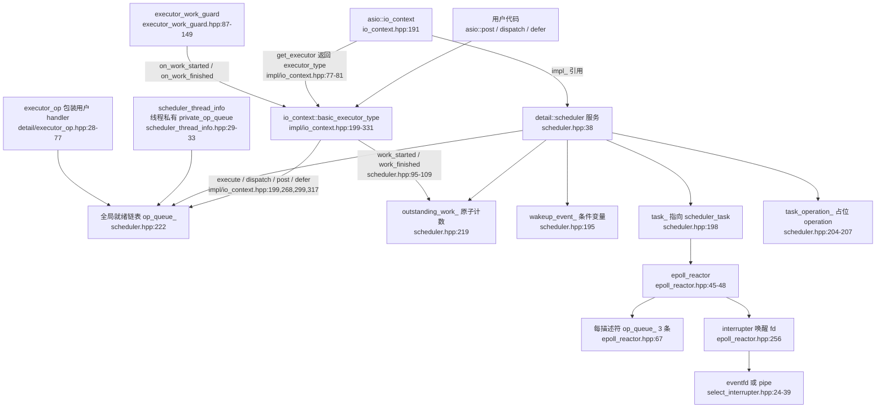
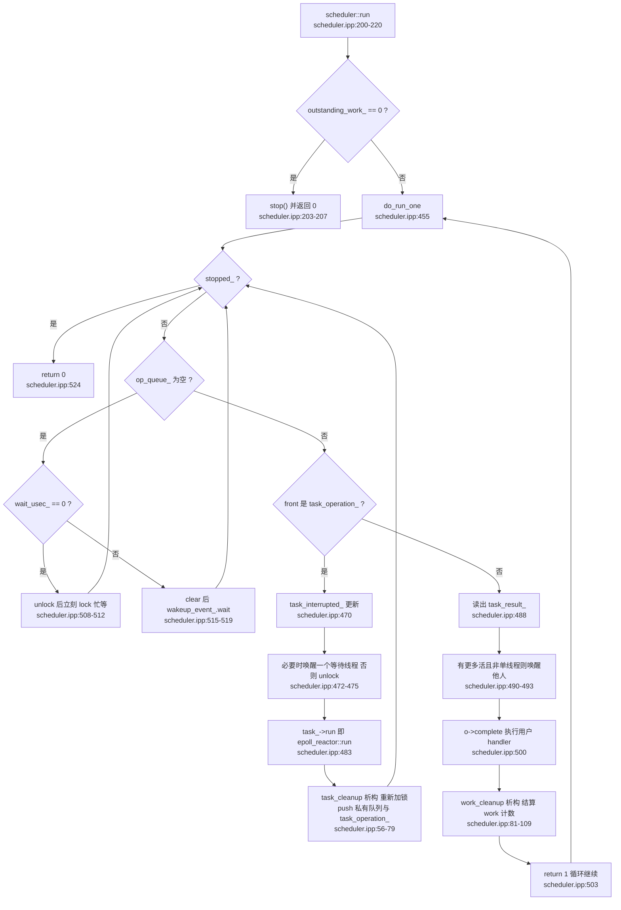
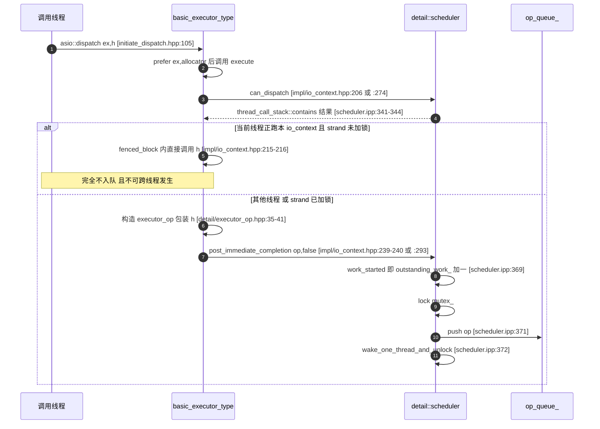
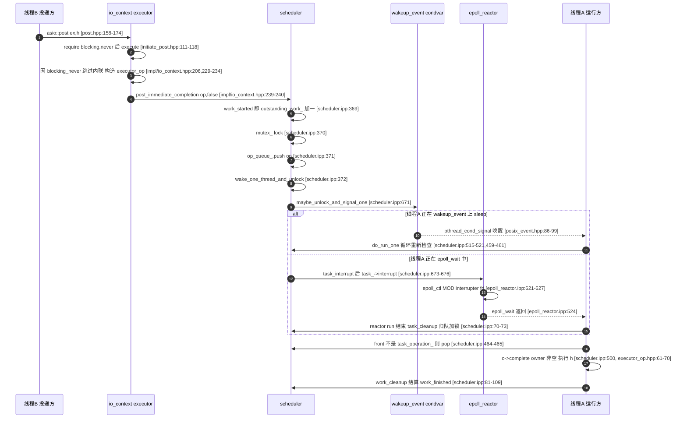
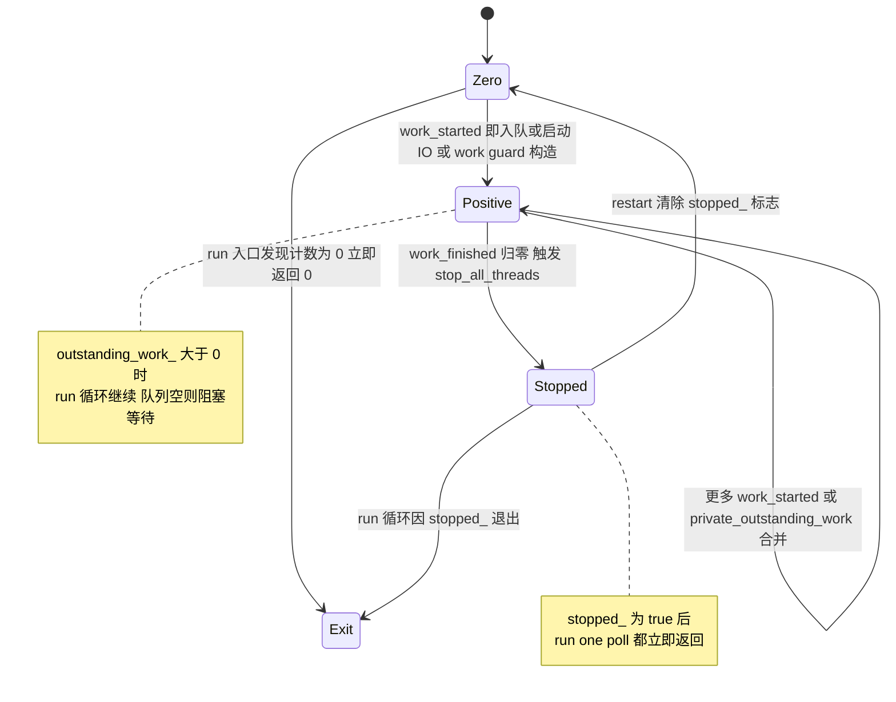

# asio io_context / executor 调度队列分析

> 分析对象：`yalantinglibs` 仓库 vendored 的 standalone asio（`include/ylt/thirdparty/asio/`）
> 版本：`ASIO_VERSION 103600`，即 **asio 1.36.0**（`include/ylt/thirdparty/asio/version.hpp:21`）
> 平台前提：本文按 **Linux + epoll + eventfd + pthread** 路径分析（`detail/config.hpp:833-862`、`1091-1101`）。
> 若在 Windows 上编译，`asio::io_context` 的 impl 会切换为 `win_iocp_io_context`（`asio/io_context.hpp:48-54`），
> 本文描述的 `detail::scheduler` 队列不再生效。yalantinglibs 在 Windows 下的实际路径需另行确认（见"疑点"）。

---

## 0. 一句话结论：executor 的"调度队列"到底是什么

**不是"每个 executor 一条任务队列"，而是 `io_context`（execution_context）内部唯一的 `detail::scheduler::op_queue_`
（侵入式单向链表，`include/ylt/thirdparty/asio/detail/scheduler.hpp:222`）**，链表元素是
`scheduler_operation`（`next_` 指针在 `detail/scheduler_operation.hpp:66`），不是 `std::function`，也不是 `std::deque`。

实际存在 **三层队列**，务必区分：

| 层 | 类型/字段 | 位置 | 作用 |
|---|---|---|---|
| 全局就绪队列 | `op_queue<operation> op_queue_` | `detail/scheduler.hpp:222` | 所有已就绪、等待被 `run()` 取走执行的 operation；受 `mutex_` 保护 |
| 线程私有暂存队列 | `op_queue<scheduler_operation> private_op_queue` | `detail/scheduler_thread_info.hpp:31` | `one_thread_`（concurrency_hint==1）或 continuation 场景下的免锁快路径；在 handler/task 返回时并入全局队列 |
| reactor 每描述符待办队列 | `op_queue<reactor_op> op_queue_[3]` | `detail/epoll_reactor.hpp:67` | 每个 fd 上尚未完成的 read/write/except 操作；IO 就绪后**不直接**把这些 op 塞进 scheduler 队列 |

关键点：IO 就绪后进入 scheduler 队列的不是"用户 handler 的 op"，而是一个**占位 operation**——
`descriptor_state`（`detail/epoll_reactor.hpp:58`，继承 `operation`）。它被当作普通 operation 取出、`complete()`
时才在 reactor 里真正分发 user handler（`detail/impl/epoll_reactor.ipp:818-829`）。

---

## 1. 组件关系图



组件职责（含行号）：

- `io_context` 只是 `execution_context` 的壳，真正的实现是 `detail::scheduler` 服务：
  `impl_(asio::make_service<impl_type>(*this, false))`，第二参 `own_thread=false`
  （`asio/impl/io_context.ipp:36-52` → `detail/impl/scheduler.ipp:111-135`）。
  `run/poll/stop/stopped/restart` 全部直通 `impl_`（`asio/impl/io_context.ipp:59-104`）。
- `executor_type = basic_executor_type<std::allocator<void>, 0>`（`asio/io_context.hpp:208`），
  内部仅保存 `uintptr_t target_`（io_context 指针 + 3 个运行时 bit），`context_ptr()` 用掩码还原
  （`asio/io_context.hpp:969-980`）。executor 本身**不持有队列**。
- `scheduler::operation` 就是 `scheduler_operation`（`detail/scheduler.hpp:43`），
  通过 `func_` 函数指针 + `task_result_` 传递完成结果（`detail/scheduler_operation.hpp:36-45,66-70`）。
- `scheduler_task` 抽象了"可被调度的 IO 引擎"（`detail/scheduler_task.hpp:28-42`），
  `epoll_reactor` 实现它（`detail/epoll_reactor.hpp:45-48`），`get_default_task()` 返回
  `use_service<reactor>(ctx)`（`detail/impl/scheduler.ipp:682-689`）。

---

## 2. executor 包装：type-erased 与 post/dispatch/defer

### 2.1 `asio::executor`（TS executor，类型擦除）

- `class executor`（`asio/executor.hpp:48`）内部 `impl_base*`（`asio/executor.hpp:297-315`）：
  `on_work_started/on_work_finished/dispatch/post/defer/context` 都是虚函数。
- 调用转发：`executor::post` → `impl<Executor,Allocator>::post` → `executor_.post(function, allocator)`
  （`asio/impl/executor.hpp:270-293`、`asio/impl/executor.hpp:96-109`）。
  也就是说 type-erasure 只是包了一层函数对象 `detail::function`，最终仍落到具体 executor 的成员函数。

### 2.2 `asio::any_io_executor`（execution::any_executor）

- `any_io_executor` 是 `execution::any_executor<...>` 的别名式子类，只声明支持的属性集
  （`asio/any_io_executor.hpp:51-76`：`context_as_t`、`blocking.never`、`prefer_only` 的 possibly/tracked/untracked/fork/continuation）。
- 具体实现文件 `asio/impl/any_io_executor.ipp:28-126` 全是转发。
- `execute()` 的分发在 `execution::any_executor_base`：两槽函数指针 `execute` / `blocking_execute`
  （`asio/execution/any_executor.hpp:865-866`），
  `target_fns_table()` 按目标是否"永远阻塞"选表（`asio/execution/any_executor.hpp:910-933`），
  `execute_ex<Ex>` 最终调用具体 executor 的 `execute()`（`asio/execution/any_executor.hpp:894-900`）。
  `any_executor_base::execute` 主体见 `asio/execution/any_executor.hpp:668-689`。

### 2.3 `execution::executor` 概念

`execution::is_executor<T>` 本质是检测 `execute_member<const T, invocable_archetype>` 有效，外加可拷贝、可相等比较等
（`asio/execution/executor.hpp:36-70,81-89`）；旧式 `asio::is_executor<T>` 转发到 `detail::is_executor`
（`asio/is_executor.hpp:32-40`）。`io_context::executor_type` 同时满足两套（因为它既有 `execute`，也有 TS 的
`context/on_work_* /dispatch/post/defer`，见 `asio/io_context.hpp:836-943`）。

### 2.4 三个动词的真实实现路径

现代接口 `asio::post(ex, token)` 走 `detail::initiate_post_with_executor`
（`asio/post.hpp:158-174`、`asio/detail/initiate_post.hpp:78-200`）：

| 动词 | 关键动作 | 证据 |
|---|---|---|
| `post` | `prefer(require(ex, blocking.never), relationship.fork, allocator).execute(h)` | `detail/initiate_post.hpp:111-118`（execution executor）；TS 分支 `ex_.post(h, alloc)` `detail/initiate_post.hpp:168-169` |
| `dispatch` | `prefer(ex, allocator).execute(h)`（**不加 blocking.never**，所以允许内联） | `detail/initiate_dispatch.hpp:105-107`；TS 分支 `ex_.dispatch` `detail/initiate_dispatch.hpp:154-155` |
| `defer` | `prefer(require(ex, blocking.never), relationship.continuation, allocator).execute(h)` | `detail/initiate_defer.hpp:111-117`；TS 分支 `ex_.defer` `detail/initiate_defer.hpp:168-169` |

`post(ctx, h)` 只是取 `ctx.get_executor()` 再转发（`asio/post.hpp:189-207`）。
三个自由函数本身都只是 `async_initiate` 的薄壳：`asio/post.hpp:79-87,158-174,189-207`、
`asio/dispatch.hpp:72-78,146-156,176-188`、`asio/defer.hpp:85-88,175-178,205-209`，
真正语义在 `detail/initiate_*.hpp` 里。

落到 `io_context::basic_executor_type` 后（这是最关键的一层）：

- `execute(f)`：若 `blocking_never` 未置位且 `can_dispatch()` 为真 → **就地执行**（`fenced_block` 包裹，
  异常被 `capture_current_exception()` 暂存，稍后从 `run()` 抛出）；否则分配
  `detail::executor_op<function_type, Allocator, detail::operation>`，调用
  `post_immediate_completion(p.p, relationship_continuation != 0)`
  （`asio/impl/io_context.hpp:199-242`，内联条件在 `:206`，入队调用在 `:239-240`）。
- `dispatch(f)`：`can_dispatch()` 直接内联（`:268-282`），否则 `post_immediate_completion(p.p, false)`（`:293`）。
- `post(f)`：直接 `post_immediate_completion(p.p, false)`（`:299-313`）。
- `defer(f)`：直接 `post_immediate_completion(p.p, true)`（`:317-331`）。

包装用户 handler 的 `executor_op`：构造函数把 `do_complete` 作为函数指针交给基类
（`detail/executor_op.hpp:35-41`）；`do_complete` 先做 handler 局部拷贝、释放 op 内存，再 `owner` 非空时
`fenced_block(half)` 调用 handler（`detail/executor_op.hpp:43-72`）。

> 注意：`asio::post` 与 `defer` 在 executor 层唯一区别就是 `is_continuation` 标志（false/true），
> 该标志只在 `scheduler::post_immediate_completion` 里决定是否走线程私有队列
> （`detail/impl/scheduler.ipp:352-373`）；`dispatch` 的"内联"判定发生在 executor 层 `can_dispatch()`
> （`detail/impl/scheduler.ipp:341-344`：`thread_call_stack::contains(this) != 0`）。

### 2.5 handler_work：完成处理时把 handler 送回"正确的 executor"

异步操作完成时不一定直接在 reactor 线程调用 handler：`detail/handler_work.hpp` 用
`asio::prefer(ex, execution::outstanding_work.tracked)` 抓住 io executor 与 handler 的 associated executor
（`detail/handler_work.hpp:59-67`、`:407-439`），`complete()` 时
`handler_work_base::dispatch` → `asio::prefer(executor_, allocator).execute(function)`
（`detail/handler_work.hpp:86-92`；any_io_executor 特化 `:395-399`）。
若 io executor 就是 `io_context::executor_type`（原生实现），对应的 `handler_work_base` 特化不再额外持有 work，
`dispatch` 直接调用 function（`detail/handler_work.hpp:177-205`）；`handler_work::complete` 在两侧都不持有
work 时也走直接调用分支（`detail/handler_work.hpp:424-438,461-475`）。

---

## 3. 队列核心：侵入式链表、task_ 与占位 operation

### 3.1 `op_queue`：最小侵入式单向链表

`template <typename Operation> class op_queue`（`detail/op_queue.hpp:62-155`）：

- 两个指针：`front_`、`back_`（`detail/op_queue.hpp:150-154`）；
- 节点链接由 `op_queue_access::next()` 直接读写 `Operation::next_`（`detail/op_queue.hpp:28-60`），
  对 `scheduler_operation` 而言就是 `scheduler_operation* next_`（`detail/scheduler_operation.hpp:66`）；
- `push(op)`：O(1) 尾插（`detail/op_queue.hpp:103-116`）；`pop()`：O(1) 头删并清空 `next_`（`:90-101`）；
- `push(op_queue<Other>& q)`：整链 splice，源队列置空（`:120-133`）——线程私有队列并入全局队列就靠它；
- `empty()`（`:136-139`）、`is_enqueued(op)`（`:142-145`，用 `next_!=0 || back_==op` 判断）。

**为什么是侵入式**：操作对象自己就是链表节点，入队/出队零分配。`operation` 派生体系：
`scheduler_operation`（函数指针 + `task_result_`）→ `reactor_op`（`ec_/bytes_transferred_/perform_func_`，
`detail/reactor_op.hpp:26-64`）→ 各 socket op；`descriptor_state` 也继承 `operation`
（`detail/epoll_reactor.hpp:58`）。

### 3.2 scheduler 的字段

`scheduler`（`detail/scheduler.hpp:38-232`）关键字段：

| 字段 | 行号 | 说明 |
|---|---|---|
| `one_thread_` | `:189` | 来自 config `scheduler.concurrency_hint==1`（`scheduler.ipp:114`），单线程优化开关 |
| `mutex_` | `:192` | `conditionally_enabled_mutex`，并发提示可关闭锁（`detail/conditionally_enabled_mutex.hpp:29-59`） |
| `wakeup_event_` | `:195` | `conditionally_enabled_event`（`detail/conditionally_enabled_event.hpp:31-99`），Linux 下即 `posix_event`（`detail/event.hpp:22-41`） |
| `task_` | `:198` | `scheduler_task*`，指向 reactor |
| `task_operation_` | `:204-207` | 一个**空壳 operation**，代表"task 在队列中的位置" |
| `task_interrupted_` | `:210` | 防止重复 `task_->interrupt()` |
| `stopped_` / `shutdown_` | `:213,216` | 停止/关闭标志 |
| `outstanding_work_` | `:219` | `atomic_count`，未完成工作计数 |
| `op_queue_` | `:222` | 全局就绪 operation 链表 |
| `task_usec_` / `wait_usec_` | `:225,228` | task 运行时间上限 / 空队列等待上限，默认 -1（`scheduler.ipp:123-124`） |

注：`scheduler` **没有**名为 `wakeup_` 的成员；与"唤醒"相关的只有两样东西——条件变量 `wakeup_event_`
（`:195`）和 `scheduler_task* task_`（`:198`）。前者用于唤醒睡在空队列上的线程，后者用于打断正在
`epoll_wait` 里的 reactor（`task_->interrupt()`），二者互补，见第 6 节。

### 3.3 task 如何"进入队列"

`scheduler::init_task()`（`detail/impl/scheduler.ipp:189-198`）：把 `task_ = get_task_(context())` 取成 reactor，
然后 `op_queue_.push(&task_operation_)` 并 `wake_one_thread_and_unlock(lock)`。
`init_task()` 由 reactor 相关 service 的构造函数触发，例如
`reactive_socket_service_base`（`detail/impl/reactive_socket_service_base.ipp:31-36`）与
`deadline_timer_service`（`detail/deadline_timer_service.hpp:70-80`）→
`epoll_reactor::init_task()`（`detail/impl/epoll_reactor.ipp:157-160`）→ `scheduler_.init_task()`。

所以：**只要构造过 socket/timer 之类用到 reactor 的对象，scheduler 队列里就会常驻一个 `task_operation_`**；
`run()` 每次轮到它，就把 reactor 当作一个"可阻塞的 operation"跑一次 `epoll_wait`。

---

## 4. do_run_one：取出与执行的主循环

`do_run_one(lock, this_thread, ec)`（`detail/impl/scheduler.ipp:455-525`）是全部调度语义的核心：

```
while (!stopped_) {                                  // :459
  if (!op_queue_.empty()) {                          // :461
    operation* o = op_queue_.front(); op_queue_.pop();// :464-465
    bool more_handlers = !op_queue_.empty();         // :466
    if (o == &task_operation_) {                     // :468
      task_interrupted_ = more_handlers || task_usec_ == 0;   // :470
      if (more_handlers && !one_thread_ && wait_usec_ != 0)
        wakeup_event_.unlock_and_signal_one(lock);   // :473
      else lock.unlock();                            // :475
      task_cleanup on_exit = {...};                  // :477
      task_->run(more_handlers ? 0 : task_usec_, this_thread.private_op_queue); // :483-484
    } else {
      std::size_t task_result = o->task_result_;     // :488
      if (more_handlers && !one_thread_) wake_one_thread_and_unlock(lock); // :490-491
      else lock.unlock();                            // :493
      work_cleanup on_exit = {...};                  // :496
      o->complete(this, ec, task_result);            // :500
      this_thread.rethrow_pending_exception();       // :501
      return 1;                                      // :503
    }
  } else {                                           // 队列空
    if (wait_usec_ == 0) { lock.unlock(); lock.lock(); }       // :508-512 轮询忙等
    else { wakeup_event_.clear(lock); wakeup_event_.wait(lock); } // :515-519 阻塞等待
  }
}
return 0;                                            // :524
```

要点：

1. **`run()` 的循环形状**：`for (; do_run_one(lock, this_thread, ec); lock.lock())`（`scheduler.ipp:216`）。
   `do_run_one` 在调用 `complete()` 前已 `unlock`，返回 1 后循环体再 `lock.lock()` 重新加锁，
   因此用户 handler 在**不持锁**状态下执行。
2. **task 分支**：`task_operation_` 出队后立即建立 `task_cleanup` 守卫，再 `unlock` 调 `task_->run(...)`；
   `task_cleanup` 析构时重新加锁，把 `private_outstanding_work` 补回 `outstanding_work_`、把
   线程私有队列 `push` 进全局队列，并把 `task_operation_` **重新 push 回队尾**
   （`scheduler.ipp:56-79`，`op_queue_.push(&scheduler_->task_operation_)` 在 `:73`）。
   这就是"task 常驻队列"的实现：一次 epoll_wait 结束时它自动回到队尾，等待下一轮。
3. **普通 operation 分支**：先读 `task_result_`（对 `descriptor_state` 来说就是 epoll 事件掩码，
   `set_ready_events` 把 events 写进 `task_result_`，`detail/epoll_reactor.hpp:72-73`），
   若队列里还有活儿且非单线程，先 `wake_one_thread_and_unlock` 叫醒另一个线程做负载分担
   （`scheduler.ipp:490-491`），然后建 `work_cleanup` 守卫、`complete()`、`return 1`。
4. **work_cleanup 的记账规则**（`scheduler.ipp:81-109`）：
   - `private_outstanding_work > 1` → 把 `n-1` 加回 `outstanding_work_`（留下 1 给本次 complete 消耗）；
   - `private_outstanding_work < 1` → 调 `work_finished()`（本次 operation 自己那份工作结束）；
   - `== 1` → 什么都不做（正好持平）；
   - 最后把线程私有队列在持锁状态下并入全局队列（`:97-103`）。

### 4.1 事件循环流程图



---

## 5. 投递路径与"内联执行"判定

### 5.1 四个插入函数（`detail/impl/scheduler.ipp`）

| 函数 | 行为 | 前提 |
|---|---|---|
| `post_immediate_completion(op, is_continuation)` `:352-373` | 若 `(one_thread_ \|\| is_continuation)` 且当前线程正在跑本 scheduler → `++private_outstanding_work` 并把 op 塞进 `private_op_queue` 返回；否则 `work_started()` + 加锁入全局队列 + `wake_one_thread_and_unlock` | 调用者未做过 `work_started` |
| `post_immediate_completions(n, ops, is_continuation)` `:375-397` | 同上，批量版；跨线程时 `increment(outstanding_work_, n)` 后整链入队 | 同上 |
| `post_deferred_completion(op)` `:399-415` | **不再 work_started**（工作已在别处计数），直接入全局队列 + 唤醒；`one_thread_` 时优先线程私有队列 | 调用者已 `work_started` |
| `post_deferred_completions(ops)` `:417-437` | 批量版；`ops` 为空直接返回 | 同上 |
| `do_dispatch(op)` `:439-446` | `work_started()` + 入全局队列 + 唤醒，**不做内联**（内联判定在调用方） | 假设调用者尚未 `work_started`；本树内未发现调用者 |

内联判定在两个地方：

- **executor 层**：`io_context::basic_executor_type::execute/dispatch` 的 `can_dispatch()`
  （`asio/impl/io_context.hpp:206,274`）；
- **strand 层**：`strand_service::do_dispatch` 额外检查 strand 锁
  （`detail/impl/strand_service.ipp:114-152`：`io_context_impl_.can_dispatch() && !impl->locked_` 才就地
  `op->complete(...)`，否则入队/等锁；`on_dispatch_exit` 与 `do_post` 用 `post_immediate_completion` 续投，
  `:40,110,150,171`）。

`can_dispatch()` 的定义就是"当前线程正处于本 scheduler 的执行栈中"：
`thread_call_stack::contains(this) != 0`（`detail/impl/scheduler.ipp:341-344`），
而 `thread_call_stack::context ctx(this, this_thread)` 在 `run/run_one/poll/poll_one` 入口建立
（`scheduler.ipp:211,233,269,300`）。

> 本树内没有找到 `scheduler::do_dispatch` 的调用者（仅有声明/定义：`scheduler.hpp:137`、`scheduler.ipp:439`），
> 推测是给内部服务/未来实现预留的 API；strand 使用的是自己的 `do_dispatch`。

### 5.2 dispatch 内联判定时序图



补充：`dispatch` 与 `post` 的区别只在"是否允许内联"，一旦决定入队，二者调用的都是
`post_immediate_completion(op, false)`（`impl/io_context.hpp:293` vs `:311`）。
`defer` 唯一区别是 `is_continuation=true`（`:329`），于是同线程内会落到私有队列、等当前 handler 返回后才被
`work_cleanup` 合并进全局队列（`scheduler.ipp:356-363, 97-103`）。

---

## 6. 跨线程唤醒：两条完全不同的路径

### 6.1 路径 A：线程在 `wakeup_event_` 上阻塞（队列空）

`do_run_one` 空队列分支先 `wakeup_event_.clear(lock)` 再 `wait(lock)`（`scheduler.ipp:515-519`）。
Linux 下 `event = posix_event`（`detail/event.hpp:22-41`），本质是 `pthread_cond_t` + 互斥量：

- 等待：`while ((state_ & 1) == 0) { state_ += 2; pthread_cond_wait(...); state_ -= 2; }`（`detail/posix_event.hpp:110-120`）；
- 唤醒一个：`unlock_and_signal_one` 先在持锁状态下置位并检查 `state_ > 1`（有 waiter），解锁后 `pthread_cond_signal`
  （`detail/posix_event.hpp:62-72`）；`maybe_unlock_and_signal_one` 返回"是否有 waiter"
  （`detail/posix_event.hpp:86-99`）。
- `scheduler::wake_one_thread_and_unlock`（`scheduler.ipp:668-680`）：
  `if (wait_usec_ == 0 || !wakeup_event_.maybe_unlock_and_signal_one(lock)) { ... task_->interrupt(); lock.unlock(); }`。
  即：**有人 sleep 在 condvar 上就 signal 它；没人睡（说明可能在 epoll_wait 里）就改走路径 B。**

### 6.2 路径 B：线程阻塞在 `epoll_wait`（reactor task 正在跑）

当 `task_operation_` 被取出且队列已空（`more_handlers==false`），`do_run_one` 会把 `task_usec_`
（默认 -1 → 无限期）传给 `task_->run()`（`scheduler.ipp:483-484`），即
`epoll_reactor::run(usec, ops)` 里的 `epoll_wait(epoll_fd_, events, 128, timeout)`（`detail/impl/epoll_reactor.ipp:523-524`）。
此时该线程不在 `wakeup_event_` 上，条件变量唤不醒它，于是走 **reactor interrupt**：

1. `wake_one_thread_and_unlock` 发现没有 condvar waiter → `task_interrupted_=true; task_->interrupt()`
   （`scheduler.ipp:671-678`）；
2. `epoll_reactor::interrupt()` 对 **interrupter 的 read fd** 做 `epoll_ctl(EPOLL_CTL_MOD, EPOLLIN|EPOLLERR|EPOLLET)`
   （`detail/impl/epoll_reactor.ipp:621-627`）；
3. 该 fd 在 reactor 构造时就已加入 epoll，并在构造末尾 `interrupter_.interrupt()` 使其保持"可读"
   （`epoll_reactor.ipp:56-61`）；配合 **边沿触发 EPOLLET**，一次 MOD 就能让 `epoll_wait` 返回；
   `run()` 收到 interrupter 事件时什么都不做，只把 `check_timers` 置真（`epoll_reactor.ipp:566-579`），
   注释明确说明"不 reset interrupter，依赖 ET 与注册更新来唤醒"（`:568-571`）；
4. interrupter 在 Linux 上优先是 **eventfd**（`ASIO_HAS_EVENTFD`，`detail/select_interrupter.hpp:24-39`；
   `detail/eventfd_select_interrupter.hpp:28-70`，`read_descriptor()` 在 `:46-50`），否则退回 pipe
   （`detail/pipe_select_interrupter.hpp`）；Windows 用 socket 版（`select_interrupter.hpp:33-34`）。
5. `epoll_wait` 返回后 `epoll_reactor::run` 结束，`task_cleanup` 重新入队并加锁（`scheduler.ipp:70-73`），
   循环回到 `!op_queue_.empty()`，取出刚才 post 进来的 op 执行。

### 6.3 跨线程 post 的完整调用链（时序图）



---

## 7. epoll reactor 如何把 IO 事件变成 scheduler 队列里的 operation

三个关键环节：

### 7.1 发起 IO：`start_op` 不把 op 放进 scheduler 队列

`epoll_reactor::start_op(...)`（`detail/impl/epoll_reactor.ipp:254-344`）：

- 先尝试"投机执行"：`op->perform()` 直接 syscall，成功则 `on_immediate(op, is_continuation, immediate_arg)`
  立即完成（`:281-292`，`on_immediate` 一路通到
  `epoll_reactor::post_immediate_completion` → `scheduler_.post_immediate_completion`，
  `detail/impl/epoll_reactor.hpp:27-31`）；
- 失败/不可投机：`descriptor_data->op_queue_[op_type].push(op)`（`:342`）——
  **放进的是 reactor 的 per-descriptor 队列**，然后 `scheduler_.work_started()`（`:343`）为这次 IO 计一份工作。
  注意此处只 `work_started`，op 本身**没有**进入 `scheduler::op_queue_`。

### 7.2 等待 IO：reactor 作为 task 阻塞在 epoll_wait

`epoll_reactor::run(usec, ops)`（`epoll_reactor.ipp:500-619`）：

1. 计算超时（`timerfd` 在用就交给 timerfd，否则问 timer 队列，`:509-520`）；
2. `epoll_wait`（`:523-524`）；
3. 遍历事件（`:563-602`）：
   - `ptr == &interrupter_` → 忽略（`:566-579`）；
   - `ptr == &timer_fd_` → 稍后检查定时器（`:580-585`）；
   - 否则是 `descriptor_state*`：`set_ready_events(events[i].events)`（写进 `task_result_`），
     若未入队则 `ops.push(descriptor_data)`，已入队则 `add_ready_events` 合并事件掩码（`:588-600`）。
     **这里 `ops` 是 `do_run_one` 传入的 `this_thread.private_op_queue`**（`scheduler.ipp:483-484`），不是全局队列；
4. 处理到期的 timer 回调，也 push 进 `ops`（`:604-618`）。

注意 `run()` 开头注释（`:502-506`）：该实现依赖 scheduler"把 reactor task 排在本轮返回的 descriptor operation 之后"，
所以这些 `descriptor_state` 复用时不会冲突。

### 7.3 回到队列：task_cleanup 批量并入，再逐个 complete

`task_->run()` 返回后 `task_cleanup` 析构，`op_queue_.push(this_thread_->private_op_queue)` 把
reactor 收集到的 `descriptor_state` 整链并入全局 `op_queue_`（`scheduler.ipp:72`），
并重新 push `task_operation_`（`:73`）。下一轮 `do_run_one` 弹出 `descriptor_state`，
以 `task_result_`（事件掩码）作为 `bytes_transferred` 调 `complete`（`scheduler.ipp:488-500`）。

`descriptor_state::do_complete`（`epoll_reactor.ipp:818-829`）→ `perform_io(events)`（`:779-816`）：

- 在 descriptor 锁内按 `except/read/write` 顺序对 `op_queue_[j]` 逐个 `op->perform()`；
- 已完成（`done/done_and_exhausted`）的 `reactor_op` 从 per-descriptor 队列弹出并收集到 `io_cleanup.ops_`；
- 返回 `first_op_`，由 `do_complete` 直接 `op->complete(owner, ec, 0)` 调用用户 handler（`:826-829`）；
- **其余已完成 op 由 `perform_io_cleanup_on_block_exit` 析构函数 `scheduler_.post_deferred_completions(ops_)`
  投回 scheduler 队列并唤醒**（`:740-771`，调用在 `:753`）；因为 `start_op` 已经 `work_started`，
  这里用 deferred 版本，不再重复计数。

work 记账的一个细节：若本次 `descriptor_state` 没有任何用户 op 完成，`perform_io_cleanup_on_block_exit`
会调 `compensating_work_started()`（`:761-765`）抵消 scheduler 马上要为这个占位 operation 执行的
`work_finished()`；对应注释"descriptor operation 本身不算工作，所以这里不调 work_started"
（`:588-590`）。这是 work 计数能够自洽的关键补偿。

---

## 8. work count 生命周期

### 8.1 三个基本操作

- `work_started()`：`++outstanding_work_`（`detail/scheduler.hpp:95-98`）；
- `work_finished()`：`if (--outstanding_work_ == 0) stop();`（`detail/scheduler.hpp:105-109`）；
  **归零即自动 stop**，这是 `run()` 能正常返回的根本原因；
- `stop()`：`stop_all_threads(lock)` → `stopped_ = true`；`wakeup_event_.signal_all(lock)`；必要时
  `task_->interrupt()`（`detail/impl/scheduler.ipp:316-320,655-666`）。

### 8.2 谁在加减

| 事件 | 动作 | 证据 |
|---|---|---|
| `io_context::run/run_one/poll*` 入口若 `outstanding_work_==0` | 直接 `stop()` 返回 0 | `scheduler.ipp:203-207,225-229,243-247,261-265,292-296` |
| post/dispatch/defer 入队（非私有队列路径） | `work_started()` | `scheduler.ipp:369` |
| 批量 immediate completion | `increment(outstanding_work_, n)` | `scheduler.ipp:393` |
| `start_op` 把 IO op 放进 per-descriptor 队列 | `scheduler_.work_started()` | `epoll_reactor.ipp:343` |
| timer 入队 | `scheduler_.work_started()` | `detail/impl/epoll_reactor.hpp:62` |
| operation 被 `do_run_one/do_wait_one/do_poll_one` 执行完 | `work_cleanup` 析构里 `work_finished()` | `scheduler.ipp:91-94,496-497,590-591,645-646` |
| 线程私有队列的 work 补偿 | `task_cleanup` 中 `increment(outstanding_work_, private_outstanding_work)` | `scheduler.ipp:60-66` |
| descriptor 占位 op 不计工作 | `compensating_work_started()` 抵消 | `epoll_reactor.ipp:588-590,761-765` |
| `executor_work_guard` 构造/析构/reset | `on_work_started/on_work_finished`（TS 分支） | `executor_work_guard.hpp:96-101,118-122,134-141` |
| execution executor 版 work guard | 持有 `prefer(ex, outstanding_work.tracked)` 的 executor | `executor_work_guard.hpp:165-171,198-202` |
| 带 `outstanding_work_tracked` 的 executor 拷贝/析构 | `impl_.work_started()/work_finished()` | `io_context.hpp:540-543,555-560`；`impl/io_context.hpp:159-165,180-185` |

补充：`scheduler::shutdown()` 会 `stop_all_threads`、`thread_.join()`，然后销毁队列中除 `task_operation_`
以外的所有 operation（`scheduler.ipp:165-187`）；由 `io_context::~io_context()` → `execution_context::shutdown()`
→ `service_registry_->shutdown_services()` 触发（`asio/impl/io_context.ipp:54-57`、`asio/impl/execution_context.ipp:67-74`）。
`restart()` 只把 `stopped_` 置回 false（`scheduler.ipp:328-332`），不动 work 计数。

### 8.3 状态图



---

## 9. 版本信息与关键宏 / 编译选项

- 版本：`ASIO_VERSION 103600`（1.36.0），`include/ylt/thirdparty/asio/version.hpp:21`。
- 平台/实现选择：
  - `ASIO_HAS_IOCP` → `io_context_impl = win_iocp_io_context`（Windows）；否则 `detail::scheduler`
    （`asio/io_context.hpp:38-54`）；
  - Linux：`ASIO_HAS_EPOLL`（`detail/config.hpp:836-842`）、`ASIO_HAS_EVENTFD`（`:843-849`）、
    `ASIO_HAS_TIMERFD`（`:850-856`）；均可用 `ASIO_DISABLE_EPOLL` / `ASIO_DISABLE_EVENTFD` 关闭；
  - `ASIO_HAS_IO_URING_AS_DEFAULT`（`:864-869`）时 `reactor = null_reactor`，`get_default_task` 改用
    `io_uring_service`（`scheduler.ipp:682-689`）——本文路径不适用；
  - 线程：`ASIO_HAS_PTHREADS`（`detail/config.hpp:1091-1101`）决定 `event = posix_event`、
    `mutex` 用 pthread（`detail/event.hpp:20-41`）。
- 并发提示：`ASIO_CONCURRENCY_HINT_*`（`detail/concurrency_hint.hpp:23-92`）；
  默认 `ASIO_CONCURRENCY_HINT_DEFAULT -1`（`:83-85`），`concurrency_hint==1` 映射为
  `ASIO_CONCURRENCY_HINT_1`（`:90-92`），经 `config_from_concurrency_hint` 服务提供
  `scheduler.concurrency_hint`（`asio/impl/config.ipp:58-99,107-117`），
  最终决定 `one_thread_`、`mutex_` 是否真正加锁、reactor 是否加锁（`scheduler.ipp:113-116`）。
- 配置键（可运行时/编译期覆盖）：`scheduler.concurrency_hint`、`scheduler.locking`、
  `scheduler.locking_spin_count`、`scheduler.task_usec`、`scheduler.wait_usec`
  （`scheduler.ipp:114-124`）；reactor 侧 `reactor.io_locking`、`reactor.registration_locking`、
  `reactor.preallocated_io_objects`（`epoll_reactor.ipp:42-54`）。

---

## 10. 给上层（coro_io / coro_rpc）的接口级结论

1. `io_context` 的"队列"只有一条：`scheduler::op_queue_`；`post` 是**跨线程安全的入队 + 计数 + 唤醒**，
   不保证顺序公平，只有 FIFO 的近似（`op_queue` 是 FIFO 链表，但多线程 `pop` 顺序由调度竞争决定）。
2. `executor` 在 `io_context` 场景下是**轻量句柄**（一个 `uintptr_t`），拷贝 executor 本身不会增加 work 计数，
   除非显式 `require(outstanding_work.tracked)`（`io_context.hpp:649-655,540-543`）或用
   `executor_work_guard` 包一层。
3. 上层封装（如 `coro_io::ExecutorWrapper`）无论怎么包，最终落到 asio 的入口只有
   `execute()`（由 post/dispatch/defer 三选一决定是否允许内联）；handler 一定在某个调用 `run()` 的线程上执行，
   若 handler 内做阻塞操作，会占住该 io_context 的一个调度线程，`op_queue_` 的消费随之变慢。
   coro_io 层如何选择 post/dispatch 需结合 `include/ylt/coro_io/io_context_pool.hpp` 另行核对（见 task-2）。
4. 关闭顺序：让 work 归零（`work_guard.reset()` 或每个 async op 完成）会由 `work_finished()`
   自动 `stop()`（`scheduler.hpp:105-109`）；显式 `io_context::stop()` 只是立刻置 `stopped_` 并唤醒所有线程，
   不清空 `op_queue_`；`restart()` 只清 `stopped_`，之后必须重新产生 work，`run()` 才不会立即返回
   （`scheduler.ipp:316-332,203-207`）。

---

## 11. 未确认疑点 / 需要进一步验证

1. **Windows 路径未覆盖**：本机是 Windows，但本文依据 Linux epoll 分支（`detail/config.hpp:833-862`）。
   Windows 下 `io_context_impl = win_iocp_io_context`（`asio/io_context.hpp:48-54`），
   队列/唤醒机制不同（IOCP 完成端口）。yalantinglibs 在 Windows 上实际走哪条分支，需要看构建脚本是否定义
   `ASIO_HAS_IOCP`（由 `ASIO_WINDOWS` 自动决定），本次未验证。
2. **`scheduler::do_dispatch` 无调用者**：全树 grep 只有声明（`scheduler.hpp:137`）与定义
   （`scheduler.ipp:439-446`），没有找到调用点；无法从代码确认其使用场景（可能为内部服务/兼容 API）。
3. **两条 handler 异常路径的语义差异**：executor 内联执行时异常被 `capture_current_exception()`
   （`impl/io_context.hpp:211-225`）暂存到 `thread_info_base`（`detail/thread_info_base.hpp:206-235`），
   由 `do_run_one` 在 `complete()` 之后 `rethrow_pending_exception()` 抛出（`scheduler.ipp:501`）；
   而队列中的 `executor_op::do_complete` 没有 try/catch（`detail/executor_op.hpp:43-72`），
   异常会直接穿过 `scheduler::run` 传播（`scheduler.ipp:500` 注释 "May throw an exception"）。
   两条路径对上层（coro_io / coro_rpc 的协程恢复）的实际影响本次未逐一验证。
4. **`wait_usec_` / `task_usec_` 默认 -1 的来源**：`scheduler.ipp:123-124` 通过 `config(ctx).get(...)` 读取，
   默认 `config_service::get_value` 返回 `nullptr`（`asio/impl/config.ipp:40-44`），即取默认 -1；
   但若上下文注入了 `config_from_string`（`config.hpp:130-134`），阻塞行为会被改写——本仓库未见使用，
   未逐一确认。
5. **`post_immediate_completions`（批量）的调用者**未追全，仅确认 reactor 侧走的是
   `post_deferred_completions`（`epoll_reactor.ipp:367,396,440,753`）。
6. **eventfd 细节**：`epoll_reactor::interrupt()`（`epoll_reactor.ipp:621-627`）只做 `epoll_ctl MOD`，
   并未每次 `write(eventfd)`；其有效前提是构造时已让 interrupter 保持可读（`:56-61`）且注册为 EPOLLET。
   若某些内核/配置下 ET 语义不生效，唤醒行为需实测确认。

---

## 附录：关键行号速查

| 主题 | 位置 |
|---|---|
| io_context 类 / executor_type / get_executor | `asio/io_context.hpp:191,208,318`；`asio/impl/io_context.hpp:77-81` |
| io_context 构造（scheduler 服务，own_thread=false） | `asio/impl/io_context.ipp:36-52`；`detail/impl/scheduler.ipp:111-135` |
| run / poll / stop / stopped / restart 直通 | `asio/impl/io_context.ipp:59-104` |
| scheduler 字段与 API | `detail/scheduler.hpp:38-232`（task_:198, op_queue_:222, work:95-109） |
| op_queue 侵入式链表 | `detail/op_queue.hpp:62-155`（push:103, pop:90, splice:120） |
| scheduler_operation / next_ / task_result_ | `detail/scheduler_operation.hpp:31-71` |
| init_task（task_operation_ 入队） | `detail/impl/scheduler.ipp:189-198` |
| post_immediate_completion（私有队列快路径） | `detail/impl/scheduler.ipp:352-373` |
| post_deferred_completion(s)（work 已计） | `detail/impl/scheduler.ipp:399-437` |
| do_run_one 主循环 | `detail/impl/scheduler.ipp:455-525` |
| task_cleanup / work_cleanup 记账 | `detail/impl/scheduler.ipp:56-109` |
| wake_one_thread_and_unlock | `detail/impl/scheduler.ipp:668-680` |
| stop_all_threads / restart | `detail/impl/scheduler.ipp:655-666,328-332` |
| executor execute/dispatch/post/defer 的入队点 | `asio/impl/io_context.hpp:199-331`（206,239,274,293,311,329） |
| post/dispatch/defer 的自由函数与 initiate_* | `asio/post.hpp:158-207`；`detail/initiate_post.hpp:94-196`；`detail/initiate_dispatch.hpp:88-182`；`detail/initiate_defer.hpp:94-196` |
| executor_op 包装与完成 | `detail/executor_op.hpp:28-77` |
| handler_work（完成时回投 executor） | `detail/handler_work.hpp:53-100,407-476` |
| any_executor type-erasure execute | `asio/execution/any_executor.hpp:668-689,865-933` |
| epoll_reactor 构造（interrupter 入 epoll） | `detail/impl/epoll_reactor.ipp:40-70` |
| start_op（per-descriptor 队列 + work_started） | `detail/impl/epoll_reactor.ipp:254-344` |
| epoll_reactor::run（epoll_wait → ready ops） | `detail/impl/epoll_reactor.ipp:500-619` |
| reactor interrupt（eventfd/pipe 唤醒） | `detail/impl/epoll_reactor.ipp:621-627`；`detail/select_interrupter.hpp:24-39` |
| perform_io / do_complete / post_deferred_completions | `detail/impl/epoll_reactor.ipp:740-829`（753,764） |
| work guard | `asio/executor_work_guard.hpp:87-149,153-237` |
| posix_event / conditionally_enabled_event | `detail/posix_event.hpp:52-120`；`detail/conditionally_enabled_event.hpp:31-99` |
| 版本 / 平台宏 / 并发提示 | `asio/version.hpp:21`；`detail/config.hpp:833-869,1091-1101`；`detail/concurrency_hint.hpp:23-92` |
