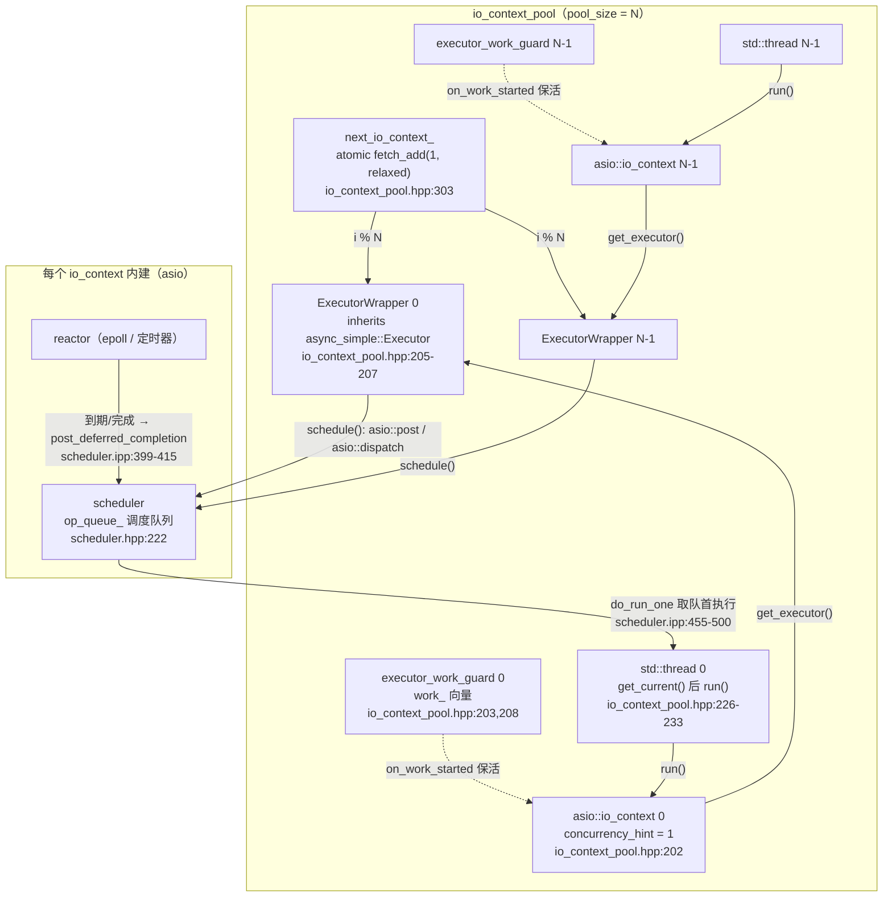
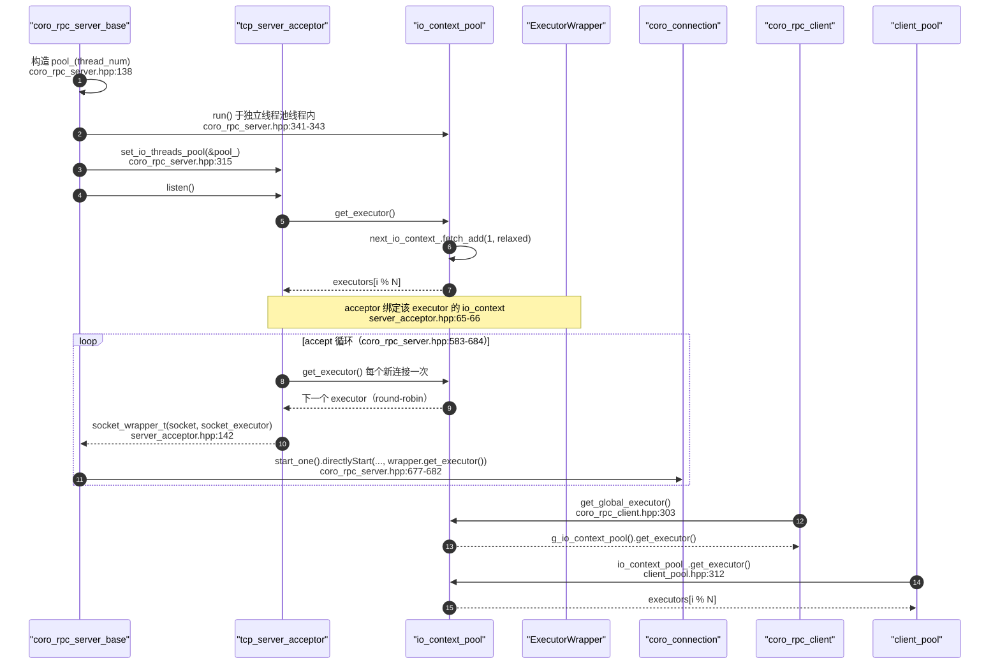
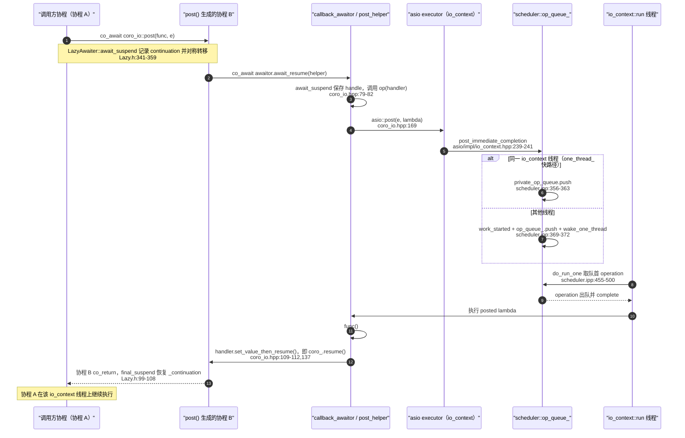
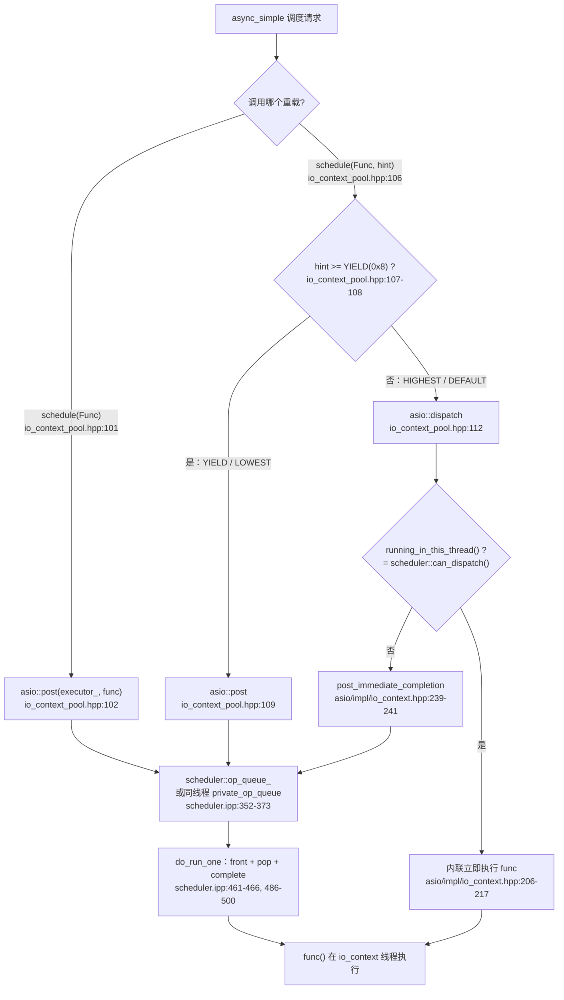
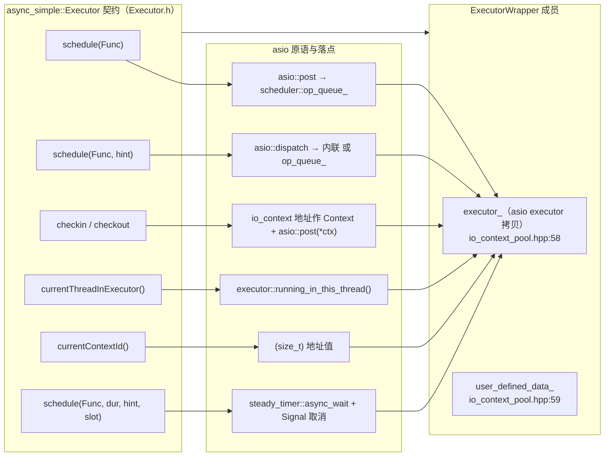

# coro_io `ExecutorWrapper` / `io_context_pool` 与 async_simple Executor 集成分析

> 分析对象：`include/ylt/coro_io/io_context_pool.hpp`、`include/ylt/coro_io/coro_io.hpp`、`include/ylt/thirdparty/async_simple/Executor.h`，以及 coro_rpc 侧使用方。
> asio 内部（`scheduler` / `op_queue` / `epoll_reactor` / `do_run_one`）的细节由同目录 `docs/analysis/asio_scheduler.md` 负责；本文只标注 **衔接点**。
> 版本基线：vendored asio `ASIO_VERSION 103600`（asio 1.36.0），见 `include/ylt/thirdparty/asio/version.hpp:21`。
> 所有路径均相对仓库根；行号取自当前主工作区（未包含 `.worktrees/`）。
> 排版约定：下文以 `asio/...`、`Executor.h`、`Lazy.h`、`Signal.h`、`Sleep.h`、`FutureState.h`、`FutureAwaiter.h` 简写的路径，分别指 `include/ylt/thirdparty/asio/...` 与 `include/ylt/thirdparty/async_simple/...`（首次出现处已给全路径）。
> 说明：本机 Windows 沙箱下 pwsh 不可用，未编译、未运行任何代码；结论全部来自源码阅读。

---

## 0. 一页结论

1. **`coro_io` 层没有自己的调度队列。** `ExecutorWrapper` 只持有 asio executor 的一份拷贝（`include/ylt/coro_io/io_context_pool.hpp:58`），`schedule()` 直接把 `Func` 转交给 `asio::post` / `asio::dispatch`（`io_context_pool.hpp:101-115`）。任务真正落点在 asio 每个 `io_context` 内部的 `scheduler::op_queue_`（`include/ylt/thirdparty/asio/detail/scheduler.hpp:222`）。
2. **`schedule(Func, hint)` 的映射是一条二分支**：`hint >= async_simple::Executor::Priority::YIELD(0x8)` → `asio::post`（永不内联，满足 async_simple 防死锁契约）；`hint < YIELD` → `asio::dispatch`（若当前线程就在该 executor 的 `run()` 内，asio 会**内联立即执行**）（`io_context_pool.hpp:106-115`；`include/ylt/thirdparty/asio/impl/io_context.hpp:206-217`）。
3. **`io_context_pool` = N 个 `asio::io_context(1)` + N 个 `executor_work_guard` + N 个 `ExecutorWrapper` + N 个线程**，四者在同一个循环里成对创建（`io_context_pool.hpp:201-209`），`run()` 为每个 context 起一个线程并 join（`io_context_pool.hpp:226-258`）。
4. **`get_executor()` 是无锁 round-robin**：`next_io_context_.fetch_add(1, relaxed) % io_contexts_.size()`（`io_context_pool.hpp:302-306`）。服务端 acceptor 在 listen 时取一次、每个新连接再取一次（`include/ylt/coro_io/server_acceptor.hpp:65,116`）；客户端每个 `coro_rpc_client` 构造时通过 `get_global_executor()` 取一次（`include/ylt/coro_rpc/impl/coro_rpc_client.hpp:302-308`）。
5. **`stop()` 的关闭链条是 `work_.clear()` → work guard 析构 → `scheduler::work_finished()` → `outstanding_work_==0` → `scheduler::stop()` → `run()` 线程返回 → `join()` → `promise_.set_value()`**（`io_context_pool.hpp:261-285`、`258`；`include/ylt/thirdparty/asio/executor_work_guard.hpp:118-122`；`scheduler.hpp:105-109`；`scheduler.ipp:655`）。
6. **`coro_io::post` 的"回到 executor"是 asio handler 里直接 `resume()` 协程**（`include/ylt/coro_io/coro_io.hpp:166-188, 109-112`），不再经过 async_simple 的二次调度；协程恢复后就在该 io_context 线程上继续跑。

---

## 1. 代码地图

| 关注点 | 位置 |
|---|---|
| `coro_io::get_current()`（thread_local 当前 io_context 指针） | `include/ylt/coro_io/io_context_pool.hpp:50-53` |
| `ExecutorWrapper<>` | `include/ylt/coro_io/io_context_pool.hpp:55-180` |
| `get_current_executor()`（协程内取当前 asio executor） | `include/ylt/coro_io/io_context_pool.hpp:182-188` |
| `io_context_pool` | `include/ylt/coro_io/io_context_pool.hpp:190-353` |
| `multithread_context_pool` | `include/ylt/coro_io/io_context_pool.hpp:359-401` |
| 全局单例池 / 全局 executor | `include/ylt/coro_io/io_context_pool.hpp:403-453` |
| `coro_io::post` / `dispatch` / `sleep_for` / `channel` | `include/ylt/coro_io/coro_io.hpp:166-255, 616-740` |
| async_simple `Executor` 抽象基类 | `include/ylt/thirdparty/async_simple/Executor.h:72-195` |
| async_simple `Signal`（定时器取消） | `include/ylt/thirdparty/async_simple/Signal.h:377-406` |
| coro_rpc 服务端 | `include/ylt/coro_rpc/impl/coro_rpc_server.hpp`、`include/ylt/coro_rpc/impl/coro_connection.hpp` |
| coro_rpc 客户端 | `include/ylt/coro_rpc/impl/coro_rpc_client.hpp` |
| 客户端连接池 | `include/ylt/coro_io/client_pool.hpp` |
| 默认配置（`executor_pool_t = io_context_pool`） | `include/ylt/coro_rpc/impl/default_config/coro_rpc_config.hpp:66` |
| asio 侧衔接 | `include/ylt/thirdparty/asio/post.hpp:158-174`、`include/ylt/thirdparty/asio/dispatch.hpp:143-157`、`include/ylt/thirdparty/asio/impl/io_context.hpp:190-295`、`include/ylt/thirdparty/asio/detail/scheduler.hpp:222`、`include/ylt/thirdparty/asio/detail/impl/scheduler.ipp:352-500` |

---

## 2. `ExecutorWrapper<ExecutorImpl>`：async_simple::Executor → asio executor 的适配层

### 2.1 类骨架

```cpp
template <typename ExecutorImpl = asio::io_context::executor_type>
class ExecutorWrapper : public async_simple::Executor {
 private:
  ExecutorImpl executor_;                                            // :58
  std::unique_ptr<std::unordered_map<std::string, std::any>> user_defined_data_; // :59
 public:
  ExecutorWrapper(ExecutorImpl executor) : executor_(executor) {}     // :62
  using context_t = std::remove_cvref_t<decltype(executor_.context())>; // :64
  ...
};
```

- 默认模板参数是 **asio 的 TS executor 类型** `asio::io_context::executor_type`（`io_context_pool.hpp:55`），不是 `io_context` 本身；`context_t` 推导为 `asio::io_context`（`:64`）。
- 适配层不增加任何队列/线程：任务存储与唤醒完全交给 asio；`ExecutorWrapper` 唯一的额外状态是 `user_defined_data_`（`:59`）。
- 继承 `async_simple::Executor`（`:56`），基类构造用默认名 `"default"`（`Executor.h:88`）。

### 2.2 `schedule()` 的两个重载与 `hint` 语义

```cpp
virtual bool schedule(Func func) override {            // io_context_pool.hpp:101
  asio::post(executor_, std::move(func));              // :102
  return true;                                         // :103
}

virtual bool schedule(Func func, uint64_t hint) override {          // :106
  if (hint >= static_cast<uint64_t>(async_simple::Executor::Priority::YIELD))  // :107-108
    asio::post(executor_, std::move(func));                        // :109
  else
    asio::dispatch(executor_, std::move(func));                    // :112
  return true;
}
```

对照 async_simple 的契约：

- `schedule(Func)` 必须"要么返回 false 表示不会执行，要么保证会执行"（`Executor.h:94-98`）。ylt 恒返回 true，且 `asio::post` 不提供失败返回、只会抛异常（OOM 等极端情况），因此契约成立（详情见 §9 疑点 6）。
- `Priority` 枚举是 4-bit 优先级，数值越小越重要：`HIGHEST=0x0, DEFAULT=0x7, YIELD=0x8, LOWEST=0xF`（`Executor.h:104-109`）。注释明确要求"level >= YIELD 时，即使其他 work 在等，也不能总是立即执行"（`Executor.h:100-103, 111-116`）。
- ylt 的实现正是把这句注释翻译成 `asio::post`（延迟、绝不内联）vs `asio::dispatch`（允许内联）。**注意比较的是整个 `uint64_t hint`，不是低 4 位**（`:107-108`），这是一个语义近似，见 §9 疑点 1。
- 内部调用方：`co_await async_simple::coro::Yield` 用 `YIELD` 作为 hint（`include/ylt/thirdparty/async_simple/coro/Lazy.h:126-131`），因此走 `post` 分支；`RescheduleLazy` 启动走的是 1 参 `schedule(Func)`（`Lazy.h:362-370`），也走 `post`。所以 dispatch 分支在当前代码树中不会出现，除非调用方显式传 `DEFAULT/HIGHEST`。

图 5（见 §8）给出了这一分支与 asio 行为的完整对应。

### 2.3 `checkin` / `checkout` / `currentThreadInExecutor` / `currentContextId`

```cpp
virtual bool checkin(Func func, void *ctx) override {          // :117
  using context_t = std::remove_cvref_t<decltype(executor_.context())>; // :118
  auto &executor = *(context_t *)ctx;                           // :119
  asio::post(executor, std::move(func));                        // :120
  return true;
}
virtual void *checkout() override { return &executor_.context(); } // :123

context_t &context() { return executor_.context(); }            // :125
auto get_asio_executor() const { return executor_; }            // :127
operator ExecutorImpl() { return executor_; }                   // :129

bool currentThreadInExecutor() const override {                 // :131
  return executor_.running_in_this_thread();                    // :132
}
size_t currentContextId() const override {                      // :135
  return (size_t)&executor_.context();                          // :136
}
```

映射关系：

| async_simple 契约 | ylt 实现 | asio 侧 |
|---|---|---|
| `checkout()` 返回"当前上下文"（`Executor.h:141-145`） | `&executor_.context()`，即 `asio::io_context` 对象地址，作为 type-erased 的 `void*` | 指针即身份标识 |
| `checkin(func, ctx)` 把任务投回同一上下文（`Executor.h:146-153`） | `asio::post(*ctx, func)` | 落点仍是该 context 的 `scheduler::op_queue_` |
| `currentContextId()`（`Executor.h:144`） | `(size_t)&context` —— 用指针值当 ID | 与 `checkout()` 返回的指针一致（同一对象地址） |
| `currentThreadInExecutor()`（`Executor.h:133-136`） | `executor_.running_in_this_thread()` | `scheduler::can_dispatch()` → `thread_call_stack::contains(this)`（`asio/impl/io_context.hpp:190-195`、`asio/detail/impl/scheduler.ipp:341-344`） |

这三者在 async_simple 内部有实际用途，说明 ylt 的映射不是装饰：

- `FutureState::scheduleContinuation()` 在"当前线程已在 executor 内"时**原地执行** continuation，否则用 `checkin(_context)` 投回 checkout 时记录的上下文（`include/ylt/thirdparty/async_simple/FutureState.h:265-299`）。
- `FutureAwaiter::await_suspend()` 在挂起前 `ex->checkout()`，完成时 `ex->checkin(continuation, ctx)`（`include/ylt/thirdparty/async_simple/coro/FutureAwaiter.h:85-104`）。
- 因此 ylt 的 `checkout`/`checkin` 正确实现了"Future 完成时回到注册时所在 io_context 线程"的语义。

另外 `context()` / `get_asio_executor()` / `operator ExecutorImpl()` 是给 ylt 自己用的逃生门：所有 asio I/O 对象（acceptor、socket、timer、resolver、channel）都用它构造，例如 `server_acceptor.hpp:66,117`、`coro_connection.hpp:173`、`coro_io.hpp:620-621,636-638,684-687`。

### 2.4 `user_defined_data`：每 executor 一个类型擦除字典

```cpp
template <typename T> std::any &set_data(std::string key, T data);        // :66-73
template <typename T> T *get_data_with_default(std::string key);          // :74-82
template <typename T> T *get_data(const std::string &key);                // :83-93
void clear_all_data();                                                    // :95-99
```

- 惰性创建（`:68-71`），key 为 `std::string`，value 为 `std::any`；`get_data_with_default` 用 `try_emplace` 插入默认值（`:80-81`）。
- 用途：把"每线程上下文"挂到 executor 上（典型：每连接的 RPC 上下文缓存）。`io_context_pool::stop()` 会给每个 executor `schedule` 一次 `clear_all_data()`（`io_context_pool.hpp:266-270`）。
- 不是线程安全容器；但按 round-robin 语义，一个 executor 只会被一个 io_context 线程执行，因此"同一线程读写"是常态。

### 2.5 两个定时器 `schedule` 重载与 `async_simple::Signal` 取消

`async_simple::Executor` 的定时调度入口是 `after(dur)` / `after(dur, schedule_info, slot)` → `TimeAwaiter`，`await_suspend` 里调用 4 参虚函数（`Executor.h:198-223`，尤其 `:209-212`），`await_resume` 检查取消并可能抛 `SignalException`（`Executor.h:213-216`）。基类默认实现是"起一个 detached 线程 sleep"（`Executor.h:178-191`），ylt 把它换成 asio `steady_timer`：

**（a）无 slot 的两参重载（`:140-146`）**

```cpp
void schedule(Func func, Duration dur) override {
  auto timer = std::make_unique<asio::steady_timer>(executor_, dur);   // :141
  auto tm = timer.get();
  tm->async_wait([fn = std::move(func), timer = std::move(timer)](auto ec) {
    fn();                                                              // :144
  });
}
```
timer 生命周期被 lambda 捕获的 `shared_ptr/unique_ptr` 续命；到期后 `fn()` 即"resume 协程"。

**（b）带 `hint` + `Slot*` 的 4 参重载（`:147-179`）** —— 这是 `co_await async_simple::coro::sleep(d)` 的真实路径（`Sleep.h:36-47` 传 `DEFAULT` + `CurrentSlot`，`Lazy.h:165-168`）：

```cpp
auto timer = std::make_shared<std::pair<asio::steady_timer, std::atomic<bool>>>(
    asio::steady_timer{executor_, dur}, false);        // :149-151
if (!slot) { ...async_wait(fn)... }                    // :152-156
else {
  if (!signalHelper{SignalType::Terminate}.tryEmplace( // :158-159
        slot, [timer](auto signalType, auto *signal) mutable {
          if (bool expected = false;
              !timer->second.compare_exchange_strong(expected, true,
                                                     std::memory_order_acq_rel))
            timer->first.cancel();                     // :162-165
        })) {
    asio::dispatch(timer->first.get_executor(), func); // :167  已取消 → 立刻投递恢复
  }
  else {
    timer->first.async_wait([fn = std::move(func), timer](const auto &ec) {
      fn();                                            // :170-172  ec 被忽略
    });
    if (bool expected = false; !timer->second.compare_exchange_strong(
            expected, true, std::memory_order_acq_rel))
      timer->first.cancel();                           // :173-176  关闭竞态
  }
}
```

取消路径的三个要点：

1. **注册**：`signalHelper::tryEmplace` 把 `Terminate` 处理器挂到 `Slot` 上；若信号已触发则返回 false（`Signal.h:377-387` → `Slot::emplace` 的 CAS/`emittedTag` 判定，`Signal.h:199-236`）。
2. **竞态窗口**：`tryEmplace` 与 `async_wait` 之间若信号先到，处理器 CAS 会成功（flag=true，但此时 timer 还没挂 wait，cancel 无意义）；随后主线程 CAS 失败 → 取消刚挂上的 wait（`:173-176`）→ handler 立刻以 `operation_aborted` 被调用 → `fn()` resume → `await_resume()` 抛 `SignalException`（`Executor.h:213-216`；`Signal.h:389-400`）。反过来若主线程先 CAS 成功（flag=true），信号处理器里的 CAS 失败 → 调 `cancel()`（`:162-165`）。
3. **`ec` 被忽略**（`:143-145`、`:170-172`）：无论正常到期还是被取消，都会 `fn()` 恢复协程；"是否取消"由 `await_resume()` 里的 `checkHasCanceled` 决定（`Signal.h:389-400`）。因此 `ExecutorWrapper` 把 async_simple 的"取消即抛异常"契约交给了 awaiter，而不是在 timer 层吞掉。

> 注：`cancel()` 之后 handler 仍会运行一次（`operation_aborted`），这依赖 asio 定时器语义：取消会以 `operation_aborted` 完成挂起的 wait。

### 2.6 `get_current_executor()`

```cpp
template <typename ExecutorImpl = asio::io_context>
inline async_simple::coro::Lazy<typename ExecutorImpl::executor_type> get_current_executor() {
  auto executor = co_await async_simple::CurrentExecutor{};      // :185
  assert(executor != nullptr);                                   // :186
  co_return static_cast<ExecutorImpl *>(executor->checkout())->get_executor(); // :187
}
```

`CurrentExecutor` 的 awaiter 直接返回 `LazyPromiseBase::_executor`（`Lazy.h:155-157`），即该协程绑定的 `async_simple::Executor*`；再用 `checkout()` 拿到 `asio::io_context*`，`static_cast` 后取 asio executor。这就是"在协程里拿到自己应该在哪个 io_context 上操作"的标准做法。

---

## 3. `io_context_pool`

### 3.1 构造：N 个 io_context + N 个 work guard + N 个 wrapper

```cpp
explicit io_context_pool(std::size_t pool_size, bool cpu_affinity = false)
    : next_io_context_(0), cpu_affinity_(cpu_affinity) {
  if (pool_size == 0) pool_size = 1;                 // :195-197
  total_thread_num_ += pool_size;                    // :199
  for (std::size_t i = 0; i < pool_size; ++i) {
    io_context_ptr io_context(new asio::io_context(1));      // :202
    auto work = asio::make_work_guard(*io_context);          // :203
    io_contexts_.push_back(io_context);                      // :204
    auto executor = std::make_unique<coro_io::ExecutorWrapper<>>(
        io_context->get_executor());                         // :205-206
    executors.push_back(std::move(executor));                // :207
    work_.push_back(std::move(work));                        // :208
  }
}
```

- `asio::io_context(1)`：`1` 是 concurrency hint。asio 把它解析成 `ASIO_CONCURRENCY_HINT_1`（`asio/impl/config.ipp:112-117`、`asio/detail/concurrency_hint.hpp:90-92`），`scheduler` 因此置 `one_thread_ = true`（`asio/detail/impl/scheduler.ipp:114`）。这与"每个 context 只跑一个线程"的用法一致，并打开同线程 post 的私有队列快路径（见 §8-E）。
- `executor_work_guard` 保证没有任务时 `run()` 也不返回：构造时 `on_work_started()`（`asio/executor_work_guard.hpp:96-101`）→ `scheduler::work_started()` 使 `outstanding_work_++`（`asio/detail/scheduler.hpp:95-98`）。
- 三个 vector 下标严格一一对应：`io_contexts_[i]` ↔ `executors[i]` ↔ `work_[i]`（同一循环、同序 push），所以 `get_executor()` 用 `% io_contexts_.size()` 索引 `executors` 是安全的（`:302-306`）。
- `total_thread_num_` 是 `inline static std::atomic<size_t>` 进程级累加计数（`:352`），`get_total_thread_num()` 暴露（`:311,355-357`）；只增不减。

### 3.2 `run()`：线程创建 / 线程局部指针 / CPU 亲和 / join / promise

```cpp
void run() {
  bool has_run_or_stop = false;
  bool ok = has_run_or_stop_.compare_exchange_strong(has_run_or_stop, true); // :213-214
  if (!ok) return;                                                          // :215-217
#ifdef __linux__
  std::vector<uint32_t> cpu_ids;
  const bool apply_cpu_affinity = cpu_affinity_ && get_available_cpus(cpu_ids); // :219-222
#endif
  std::vector<std::shared_ptr<std::thread>> threads;                        // :225
  for (std::size_t i = 0; i < io_contexts_.size(); ++i) {
    threads.emplace_back(std::make_shared<std::thread>(
        [](io_context_ptr svr) {
          auto ctx = get_current();                                         // :229
          *ctx = svr.get();                                                 // :230
          svr->run();                                                       // :231
        },
        io_contexts_[i]));                                                  // :233
    /* :235-252 若 apply_cpu_affinity：CPU_SET(cpu_ids[i % n]) + pthread_setaffinity_np */
  }
  for (std::size_t i = 0; i < threads.size(); ++i) threads[i]->join();      // :255-257
  promise_.set_value();                                                     // :258
}
```

- 每个线程只 `run()` 一个 context（`:231`），线程数与 context 数相等；`svr` 按值捕获 `shared_ptr<asio::io_context>`（`:228-233`），保证 context 在线程运行期间存活。
- 线程局部 `get_current()`（`:50-53`）被设置成当前 `asio::io_context*`（`:229-230`），供 `coro_io::sleep_for` 的兜底路径使用（`coro_io.hpp:667-671`）。
- CPU 亲和只在 Linux 编译进来（`#ifdef __linux__`，`:219,235`），且需要构造时 `cpu_affinity=true`；`get_available_cpus` 用 `sched_getaffinity` 枚举（`:317-342`）。
- `run()` 阻塞直到所有 IO 线程退出（`:255-257`），然后 `promise_.set_value()`（`:258`）——这个 promise 是 `stop()` 等待"run 已彻底结束"的同步点。
- `has_run_or_stop_` 的 CAS（`:213-217`）保证 `run()` / `stop()` 只生效一次；重复调用 `run()` 直接静默返回（不会等待）。

### 3.3 `stop()` 与生命周期

```cpp
void stop(bool force = false) {
  std::call_once(flag_, [this, force] {                            // :262
    bool has_run_or_stop = false;
    bool ok = has_run_or_stop_.compare_exchange_strong(has_run_or_stop, true); // :263-264
    for (auto &executor : executors) {                             // :266
      executor->schedule([&executor]() { executor->clear_all_data(); }); // :267-269
    }
    work_.clear();                                                 // :272
    for (auto &e : io_contexts_) {
      if (ok) e->poll();        // 未 run() 过：清掉就绪 handler          // :274-277
      if (force) e->stop();     // 强制：放弃未完成 operation            // :278-280
    }
    if (!ok) promise_.get_future().wait();  // run 已启动 → 等它 join 完  // :282-283
  });
}
~io_context_pool() { if (!has_stop()) stop(); }                    // :287-290
```

- `ok` 的含义是"CAS 成功，即 `run()` **从未**启动"。此时没有 `run()` 线程，函数自己 `poll()` 把就绪 handler 执行掉（`:276`），也就无需等 promise。
- `ok == false`（`run()` 已启动或已推进过状态）：`work_.clear()` 释放所有 work guard → `outstanding_work_` 归零 → `scheduler::work_finished()` 触发 `stop()`（`scheduler.hpp:105-109`）→ `stop_all_threads`（`scheduler.ipp:655`）→ `do_run_one` 的 `while (!stopped_)` 退出（`scheduler.ipp:459`）→ `run()` 返回 → `promise_.set_value()`；`stop()` 在 `:282-283` 等这个 promise。
- 语义差异：`force=false` 时，已挂起的异步操作（读/写/定时器）会先完成，`run()` 才退出——**可能长时间不返回**；`force=true` 调 `asio::io_context::stop()`（`asio/impl/io_context.ipp:91-94`）让 `run()` 立刻返回，未执行的 operation 被放弃。
- `stop()` 对每个 executor 的 `clear_all_data()` 是"投递"而不是同步调用（`:267`），所以要么由运行中的线程执行，要么在 `ok` 分支被 `poll()` 执行；`force=true` 时该任务可能被丢弃（只影响 `user_defined_data_`，析构时仍会释放）。
- `has_stop()` 的判据是 `work_.empty()`（`:298`），不是"线程已 join"；析构函数据此避免二次 `stop()`（`:287-290`）。
- 默认 `force=false` + 等待 promise，意味着 **io_context_pool 析构可能阻塞在所有未完成 I/O 上**；这是使用方需要注意的行为。

### 3.4 访问器与 round-robin

```cpp
std::size_t pool_size() const noexcept { return io_contexts_.size(); }      // :292
std::span<std::unique_ptr<coro_io::ExecutorWrapper<>>> get_all_executor();  // :294-296
bool has_stop() const { return work_.empty(); }                             // :298
size_t current_io_context() { return next_io_context_ - 1; }                // :300
coro_io::ExecutorWrapper<> *get_executor() {                                // :302
  auto i = next_io_context_.fetch_add(1, std::memory_order::relaxed);       // :303
  auto *ret = executors[i % io_contexts_.size()].get();                     // :304
  return ret;
}
```

- `fetch_add` 用 `relaxed`：只需要"每调用一次取下一个下标"的原子性，不承担任何同步语义；溢出回绕由取模处理（`:303-304`）。
- `executors` 在构造后不再增删（`:201-209`），因此并发 `get_executor()` 无数据竞争。
- `current_io_context()`（`:300`）返回"最近一次分配的下标 - 1"，并发下不精确、未做取模、未分配前会下溢——仅作诊断用途。

**图 1：`io_context_pool` 内部结构**



**图 2：`io_context_pool` 生命周期**

```mermaid
stateDiagram-v2
    state "已构造：N 个 io_context + work_guard + wrapper" as Constructed
    state "运行中：每 context 一个线程执行 run()" as Running
    state "停止中：work_ 已清空，等待 run() 线程 join" as Stopping
    state "已停止：线程已 join，promise 已 set" as Stopped
    state "未 run 直接 stop：poll 清就绪任务后结束" as StoppedNoRun

    [*] --> Constructed
    Constructed --> Running: run() CAS 成功并起 N 个线程
    Constructed --> StoppedNoRun: stop() 时 CAS 成功 ok==true
    Running --> Stopping: stop(force=false) 清 work_
    Running --> Stopping: stop(force=true) 清 work_ 且 io_context::stop()
    Stopping --> Stopped: run() join 完成，promise_.set_value()
    StoppedNoRun --> [*]: poll() 清就绪 handler
    Stopped --> [*]: 析构函数见 has_stop() 为真，不再 stop()
    Constructed --> [*]: 析构未 run 也未显式 stop 时由 stop() 兜底
```

**图 3：`get_executor()` round-robin 与客户端/服务端取用**



---

## 4. `multithread_context_pool` 与全局单例

### 4.1 `multithread_context_pool`：1 个 context × N 线程

```cpp
class multithread_context_pool {
  multithread_context_pool(size_t thd_num = std::thread::hardware_concurrency())
      : work_(std::make_unique<work_type>(asio::make_work_guard(ioc_))),   // :362
        executor_(ioc_.get_executor()),                                    // :363
        thd_num_(thd_num) {}
  ~multithread_context_pool() { stop(); }                                  // :366
  void run() {
    for (size_t i = 0; i < thd_num_; i++)
      thds_.emplace_back([this] { ioc_.run(); });                          // :369-373
    promise_.set_value();                                                  // :375
  }
  void stop() {
    if (thds_.empty()) return;                                             // :379-381
    work_.reset();                                                         // :383
    for (auto &thd : thds_) thd.join();                                    // :384-386
    promise_.get_future().wait();                                          // :387
    thds_.clear();                                                         // :388
  }
  coro_io::ExecutorWrapper<> *get_executor() { return &executor_; }        // :391
  asio::io_context ioc_;                                                   // :394
  std::unique_ptr<work_type> work_;                                        // :396
  coro_io::ExecutorWrapper<> executor_;                                    // :397
  size_t thd_num_;                                                         // :398
  std::vector<std::thread> thds_;                                          // :399
  std::promise<void> promise_;                                             // :400
};
```

- 与 `io_context_pool` 正好相反：**一个** `io_context` 被 **N 个**线程同时 `run()`（`:369-373`），所以 `get_executor()` 永远返回同一个 wrapper（`:391`）——没有 round-robin，也就没有"每线程独立上下文"的保证。
- 它同样满足 `io_context_pool` 的鸭子接口（`run()` / `stop()` / `get_executor()` / 构造接收 size），因此可作为模板参数替换：`coro_io::g_block_io_context_pool<coro_io::multithread_context_pool>(1)`（`src/coro_io/tests/test_rate_limiter.cpp:84`）、`create_io_context_pool<coro_io::multithread_context_pool>()`（`src/coro_io/tests/test_corofile.cpp:331,359`）。
- 差异细节：`stop()` 在 `thds_` 为空时直接返回（`:379-381`）——若从未 `run()`，`work_` 不会被 reset；`run()` 无重复调用保护（重复调用会让 `thds_` 继续增长）。

### 4.2 全局单例

```cpp
template <typename T = io_context_pool>
inline T &g_io_context_pool(unsigned pool_size = std::thread::hardware_concurrency()) { // :403-405
  static auto _g_io_context_pool = std::make_shared<T>(pool_size);        // :406
  [[maybe_unused]] static bool run_helper = [](auto pool) {               // :407
    std::thread thrd{[pool] { pool->run(); }};
    thrd.detach();                                                        // :411
    return true;
  }(_g_io_context_pool);
  return *_g_io_context_pool;                                             // :414
}

template <typename T = io_context_pool>
inline std::shared_ptr<T> create_io_context_pool(unsigned pool_size = ...); // :417-427（堆上池 + detached run 线程）

template <typename T = io_context_pool>
inline T &g_block_io_context_pool(unsigned pool_size = ...);                // :429-441（与 g_io_context_pool 同构）

inline auto get_global_executor(unsigned pool_size = ...) {                 // :443-447
  return g_io_context_pool<T>(pool_size).get_executor();
}
inline auto get_global_block_executor(unsigned pool_size = ...) {           // :449-453
  return g_block_io_context_pool<T>(pool_size).get_executor();
}
```

- 两个全局池**互相独立**：`g_io_context_pool`（普通 I/O）与 `g_block_io_context_pool`（阻塞/CPU 任务）。后者的典型默认值出现在 `coro_io::post` 的默认参数（`coro_io.hpp:230`）、`coro_file` 构造默认值（`include/ylt/coro_io/coro_file.hpp:198-199,207-208,469-479`）、`channel` 默认 executor（`coro_io.hpp:697,704`）。
- 用函数内 `static` + `std::make_shared`（`:406,432`）保证 C++11 magic static 的线程安全初始化；`run_helper` 再以 detached 线程驱动 `run()`（`:407-412`），所以单例池随进程存活、不析构（`~io_context_pool` 不会在正常退出时卡住）。
- 传参注意：`g_io_context_pool<T>(pool_size)` 的 `pool_size` **只在首次调用时生效**（`static` 初始化），后续调用传入不同值不会重建池。

---

## 5. `coro_io::post` / `dispatch` / `sleep_for` / `channel`：如何回到 executor

### 5.1 `post_helper` / `dispatch_helper`

`coro_io` 的 awaitable 采用统一模式：`callback_awaitor` 把 `asio` 回调风格 API 转成 `co_await`：

```cpp
void await_suspend(std::coroutine_handle<> handle) noexcept {  // coro_io.hpp:79-82
  awaitor.coro_ = handle;
  op(awaitor_handler{&awaitor});                               // 触发自定义 asio 调用
}
auto coAwait(async_simple::Executor *executor) const noexcept { return *this; } // :83-85
void resume() const { obj->coro_.resume(); }                   // :137
```

`post_helper` / `dispatch_helper` 是这套机制的两个特化：

```cpp
template <typename R, typename Func, typename Executor>
struct post_helper {
  void operator()(auto handler) {
    asio::post(e, [this, handler]() {                          // :169
      try {
        if constexpr (std::is_same_v<R, async_simple::Try<void>>) {
          func();                                              // :172
          handler.resume();                                    // :173
        } else {
          auto r = func();
          handler.set_value_then_resume(std::move(r));         // :177
        }
      } catch (const std::exception &e) { ... handler.resume(); } // :179-183
    });
  }
  Executor e;   // :186
  Func func;    // :187
};
// dispatch_helper 同构，只是 :193 用 asio::dispatch(e, ...)
```

对外接口：

```cpp
template <typename Func, typename Executor>
inline async_simple::coro::Lazy<async_simple::Try<...>> post(Func func, Executor executor) { // :214-224
  using R = ...;
  callback_awaitor<R> awaitor;
  post_helper<R, Func, Executor> helper{executor, std::move(func)};
  co_return co_await awaitor.await_resume(helper);              // :223
}
template <typename Func>
inline ... post(Func func, coro_io::ExecutorWrapper<> *e = coro_io::get_global_block_executor()) { // :226-232
  return coro_io::post(std::move(func), e->get_asio_executor()); // :231
}
// dispatch 对应 :234-243；另有 dispatch(Executor) 形式：:245-255
```

关键点：

- `post(Func, ExecutorWrapper*)` 把 wrapper 降级成 asio executor（`:231`），所以真正投递目标是 asio，而不是 async_simple 的 `schedule`。这也是为什么 `ExecutorWrapper::schedule` 与 `coro_io::post` 是**两条独立路径**（前者服务于 async_simple 调度器，后者服务于协程内部显式切换线程）。
- `post` 的执行语义 = `asio::post`（延迟、不内联）；`dispatch` = `asio::dispatch`（若已在目标线程则内联，见 `coro_io.hpp:247-250` 对 `running_in_this_thread()` 的快速返回）。
- 恢复是在 asio handler 内直接 `coro_.resume()`（`:173, :177`）：即协程在目标 io_context 线程上继续执行，**不经过 async_simple 的 schedule/checkin**。

### 5.2 `dispatch(Executor)`：跨线程切换的标准写法

```cpp
template <typename Executor>
inline async_simple::coro::Lazy<async_simple::Try<void>> dispatch(Executor executor) { // :245
  if (executor.running_in_this_thread()) {   // :248
    co_return async_simple::Try<void>{};     // :249
  }
  co_return co_await coro_io::dispatch([]() {}, executor); // :251-254
}
```

使用示例：`tcp_server_acceptor::accept()` 先 `co_await coro_io::dispatch(executor_->get_asio_executor())`（`server_acceptor.hpp:119`）把执行流钉到 acceptor 自己的 io_context 线程，再 `async_accept`（`:120`）；`ib_socket`/`urma_socket`/`nd_socket` 也用同样手法（`include/ylt/coro_io/ibverbs/ib_io.hpp:501-503`、`urma/urma_io.hpp:80-81`、`networkdirect/nd_io.hpp:188`）。

### 5.3 `sleep_for`：走 `ExecutorWrapper` 定时器重载

```cpp
template <typename Duration, typename Executor>
inline async_simple::coro::Lazy<bool> sleep_for(Duration d, Executor *e) { // :650-655
  coro_io::period_timer timer(e);                                          // :652
  timer.expires_after(d);
  co_return co_await timer.async_await();
}
template <typename Duration>
inline async_simple::coro::Lazy<bool> sleep_for(Duration d) {              // :656-676
  if (auto executor = co_await async_simple::CurrentExecutor{}; executor != nullptr) {
    try { co_await async_simple::coro::sleep(d); }                          // :661
    catch (const async_simple::SignalException &e) { co_return false; }     // :662-663
    co_return true;
  }
  else if (auto ioc = coro_io::get_current(); ioc != nullptr && *ioc != nullptr) {
    coro_io::ExecutorWrapper<> e((**ioc).get_executor());                   // :669
    co_return co_await sleep_for(d, &e);
  }
  else {
    co_return co_await sleep_for(d, coro_io::g_io_context_pool().get_executor()); // :673-674
  }
}
```

- 有 `CurrentExecutor` 时走 async_simple `sleep` → `after()` → `ExecutorWrapper::schedule(handle, dur, DEFAULT, slot)`（`Sleep.h:36-47`、`Executor.h:209-212`、`io_context_pool.hpp:147-179`），即 asio `steady_timer`。
- 没有 async_simple executor（例如裸线程里跑协程）时，用线程局部 `get_current()` 找回当前 `io_context`（`:667-671`，由 `io_context_pool::run()` 的线程体设置，`io_context_pool.hpp:229-231`）；再不行退到全局池（`:673-674`）。

### 5.4 `channel`：把 asio channel 绑到 executor

```cpp
template <typename R>
struct channel : public asio::experimental::channel<void(std::error_code, R)> { // :678-679
  channel(coro_io::ExecutorWrapper<> *executor, size_t capacity)
      : executor_(executor),
        asio::experimental::channel<void(std::error_code, R)>(
            executor->get_asio_executor(), capacity) {}              // :684-687
  auto get_executor() { return executor_; }                          // :688
};
inline channel<R> create_channel(size_t capacity,
    coro_io::ExecutorWrapper<> *executor = coro_io::get_global_executor()); // :694-699
```

`async_send` / `async_receive` 通过通用 `async_io` 适配（`:708-740`），而 `async_io` 的取消路径里又用 `obj.get_executor()` 和 `asio::dispatch(executor, ...)` 回到同一线程（`:288, :314`）。

### 5.5 `async_io`：I/O + 取消 + 生命周期

`async_io`（`coro_io.hpp:274-370`）是所有 socket 读写的公共适配器：

- 无 `Slot` 时直接挂回调（`:280-286`），回调里 `handler.resume()`（`:283`）。
- 有 `Slot` 时注册 `Terminate` 取消处理器（`:294-312`），取消状态下用 `asio::dispatch(executor, ...)` 立刻让协程以 `operation_canceled` 恢复（`:313-319`）；正常情况下先清 slot 再 resume（`:321-325`）；完成后还要与"取消正在进行"的标志做一次 CAS 收尾（`:326-338`、`:341-367`），必要时用 `co_await coro_io::post([](){}, executor)` 循环让出，直到取消结束（`:357-363`）。

> 这正是 `ExecutorWrapper` 的 `checkin/checkout` 之外，ylt 自己维护的一套"回到 socket 所属 io_context"的纪律：**socket/timer/channel 的 executor 由创建它们的 io_context 决定，回调天然在该 io_context 线程执行**。

**图 4：`co_await coro_io::post(executor)` 从投递到恢复**



> 注意：这条链路里**没有** `async_simple::Executor::checkin`。`coro_io::post` 只借用 asio 队列把 `func` 跑到目标线程，协程自己的 `_executor`（用于后续 `Yield`/`RescheduleLazy`/`Future` continuation）仍是 `coAwait` 时继承的那个（`Lazy.h:380-388, 655-663`）。

---

## 6. async_simple::Executor 契约符合性

| 契约（`Executor.h`） | ylt 实现（`io_context_pool.hpp`） | 是否符合 |
|---|---|---|
| `schedule(Func)` 必执行或返回 false（`:94-98`） | `asio::post` 后恒 `true`（`:101-104`） | 符合（asio 仅 OOM 抛异常） |
| `schedule(Func, schedule_info)`，`>= YIELD` 不得总立即执行（`:100-119`） | `>= YIELD` → `post`；否则 `dispatch`（`:106-115`） | 基本符合，但比较未掩码（疑点 1） |
| `currentThreadInExecutor()`（`:133-136`） | `running_in_this_thread()`（`:131-133`） | 符合 |
| `stat()`（`:137-139`） | 未 override | 不符合（基类抛 `std::logic_error`；当前 async_simple 无调用点） |
| `currentContextId()`（`:144`） | `(size_t)&context`（`:135-137`） | 符合（指针即 ID） |
| `checkout()/checkin()`（`:141-153`） | `&context` / `asio::post(*ctx)`（`:117-123`） | 符合 |
| `after(dur[, info, slot])` → `schedule(Func, Duration, info, slot)`（`:157-164, 178-191, 198-223`） | `steady_timer` + `Signal` 取消（`:147-179`） | 符合 |
| `schedule(Func, Duration)`（`:173-177`） | 也 override 了（`:140-146`），但**无调用方**（基类 2 参改为委托 4 参） | 死代码（疑点 2） |
| `getIOExecutor()`（`:166-170`） | 未 override | 不符合（基类抛异常；当前无调用点） |
| `schedule_move_only`（`:121-131`） | 继承基类实现 → 转调 `schedule` | 符合 |
| `name()`（`:155`） | 基类默认 `"default"`（`:88`） | 符合（名字可选） |

补充：async_simple 的 `YieldAwaiter` 用 `YIELD` 调 `schedule(handle, YIELD)`（`Lazy.h:126-131`）；`FutureState` 的续体走 `checkin` 或 `schedule`（`FutureState.h:265-299`）；`TimeAwaiter` 走 4 参 timer `schedule`（`Executor.h:209-212`）。这三条是 async_simple → ylt 的 **全部** 热路径，均已覆盖。

---

## 7. 使用方：coro_rpc server / client / client_pool

### 7.1 服务端

- 配置中 `executor_pool_t = coro_io::io_context_pool`（`include/ylt/coro_rpc/impl/default_config/coro_rpc_config.hpp:66`），线程数来自 `config.thread_num`（`:42`）。
- `coro_rpc_server_base` 持有 `pool_`：构造函数 `pool_(thread_num)`（`coro_rpc_server.hpp:138,149,160`），成员声明见 `:787`。
- `async_start()`：
  - 给每个 acceptor 注入池指针 `acceptor->set_io_threads_pool(&pool_)`（`:315`；setter 见 `server_acceptor.hpp:46-49`，成员 `pool_` 见 `:59`）；
  - `acceptor->listen()`（`:316`）里 `executor_ = pool_->get_executor()`（`server_acceptor.hpp:65`）并用该 executor 构造 `asio::ip::tcp::acceptor`（`:66`）——**acceptor 从此固定在一个 io_context 上**；
  - 在独立线程里跑 `pool_.run()`（`:341-343`），随后 `accept().start(...)`（`:354`）启动接受循环；`accept()` 用 `collectAny` 并发跑所有 acceptor 的 `accept_impl`（`:562-577`）。
- 每个新连接：
  - `accept()` 里 `auto socket_executor = pool_->get_executor();`（`server_acceptor.hpp:116`）——**每连接 round-robin 换一个 executor**；
  - `asio::ip::tcp::socket socket(socket_executor->get_asio_executor());`（`:117`），`co_await coro_io::dispatch(executor_->get_asio_executor());`（`:119`）先钉到 acceptor 线程再 `async_accept`（`:120`）；
  - 返回 `socket_wrapper_t{std::move(socket), socket_executor}`（`:142`），executor 指针随 socket 一起传递；
  - `coro_rpc_server_base::accept_impl` 构造 `coro_connection`（`coro_rpc_server.hpp:656-657`）并 `start_one(...).directlyStart(cb, wrapper.get_executor())`（`:677-682`），把连接协程绑定到该连接的 executor。
- 连接内部：
  - `coro_connection` 的 `executor_t = coro_io::ExecutorWrapper<>`（`coro_connection.hpp:168`），构造函数用 `socket_wrapper_.get_executor()->get_asio_executor()` 建超时 timer（`:169-173`）；
  - `get_executor()` 返回 wrapper 指针（`:557`），handler 完成回调里 `executor->schedule([...]{ direct_response_msg(...); })` 把响应拉回连接所在线程（`:373-383`）；
  - `response_msg` / `response_error` 用 `asio::dispatch(socket_wrapper_.get_executor()->get_asio_executor(), ...)`（`:476-490`、`:502-519`）；
  - `async_close()` 用 `schedule(...)` 投递 `close()`（`:537-544`）。
- 停止：`stop()` 先 `acceptor->close()`（`coro_rpc_server.hpp:399`）与关闭连接（`:400-411`），再 `pool_.stop()`（`:414`），最后 join 运行 `pool_.run()` 的线程（`:417-419`）。`~coro_rpc_server_base()` 也调 `stop()`（`:207-210`）。

### 7.2 客户端

- `coro_rpc_client(executor = coro_io::get_global_executor(), ...)`（`coro_rpc_client.hpp:302-315`）：**默认每个客户端从全局池 round-robin 取一个 executor**；timer 用 `executor->get_asio_executor()`（`:305-307`），`control_t` 保存 wrapper 指针（`:308`、`:1549-1554`），`socket_wrapper_(executor_, local_ip)`（`:1554`）。
- `get_executor()` 返回 `*control_->executor_`（`:1051`）。
- 关闭：`close_socket_async()` 用 `asio::dispatch(control->socket_wrapper_.get_executor()->get_asio_executor(), ...)`（`:1565-1568`）；`close_socket()` 用 `co_await coro_io::post([]{}, control->executor_)`（`:1576-1587`）做"排空/等待"。
- `client_pool`：
  - 构造保存 `io_context_pool_t& io_context_pool_`（`client_pool.hpp:648`，构造函数 `:421-430`），默认参数 `coro_io::g_io_context_pool()`（`:416`）；
  - `get_client()` 里缓存的空闲连接用完后，`auto executor = io_context_pool_.get_executor(); client = make_unique<client_t>(executor);`（`:312-313`）——**新建连接同样 round-robin**；
  - `alive_detect()` 用 `io_context_pool_.get_executor()`（`:233-234`）；
  - 空闲收集器的 Lazy 用 `coro_io::get_global_executor()` 启动（`:344`）；
  - `client_pools` 聚合器默认绑定 `g_io_context_pool()`（`:663-666`），`g_clients_pool()` 默认参数同（`:741-749`），并暴露 `get_io_context_pool()`（`:688`）。

### 7.3 其他使用方

- coro_file 默认 `get_global_block_executor()`（`coro_file.hpp:198-199,207-208,469-479`）；
- IB verbs / URMA / NetworkDirect 的 socket 都持有 `ExecutorWrapper<>*`（`ibverbs/ib_socket.hpp:77,463-474`、`urma/urma_socket.hpp:127,894-904`、`networkdirect/nd_socket.hpp:71,265-274`），`socket_wrapper_t::get_executor()` 统一返回该指针（`socket_wrapper.hpp:236,371`）；
- cuda_stream 也持有 pool 的 executor（`include/ylt/coro_io/cuda/cuda_stream.hpp:68-88`）。

---

## 8. 与 asio 调度队列的衔接点（核心）

> 结论先说：**ylt 的"调度队列"就是每个 `io_context` 内 asio `scheduler::op_queue_`（侵入式单向链表，元素是 `scheduler::operation`）**，见 `asio/detail/scheduler.hpp:222`（`op_queue<operation> op_queue_;`）与 `asio/detail/scheduler_operation.hpp`。ylt 不另建队列，`ExecutorWrapper` 也不缓存任务。

### A. `schedule(Func)` / hint>=YIELD → `asio::post`

```
ExecutorWrapper::schedule                io_context_pool.hpp:101-104 / 109
  → asio::post(executor_, func)          asio/post.hpp:161-174
  → initiate_post_with_executor           asio/detail/initiate_post.hpp:111-118
      require(ex, blocking.never).execute  （禁止内联的关键）
  → io_context::basic_executor_type::execute
                                         asio/impl/io_context.hpp:199-242（:206 因 blocking_never 跳过内联）
  → scheduler::post_immediate_completion  asio/impl/io_context.hpp:239-241
                                         asio/detail/impl/scheduler.ipp:352-373
```

落点：`scheduler::op_queue_`（`scheduler.ipp:369-372`：`work_started(); lock; op_queue_.push(op); wake_one_thread_and_unlock`）。

> 若 `ExecutorImpl` 走 asio 的 TS executor 分支（`initiate_post.hpp:151-170` 的 `ex_.post(...)`），最终也是 `io_context::basic_executor_type::post` → `post_immediate_completion`（`asio/impl/io_context.hpp:299-311`），落点相同。

### B. `schedule(Func, hint<YIELD)` → `asio::dispatch`

```
ExecutorWrapper::schedule(func, hint)    io_context_pool.hpp:106-115（:112）
  → asio::dispatch(executor_, func)      asio/dispatch.hpp:143-157
  → initiate_dispatch_with_executor      asio/detail/initiate_dispatch.hpp:105-107
      prefer(ex, allocator).execute
  → io_context::basic_executor_type::execute（blocking.possibly 默认）
                                         asio/impl/io_context.hpp:199-242
      ├─ can_dispatch() == true  → 拷贝 func 并**立即内联执行** :206-217
      └─ 否则                      → post_immediate_completion :239-241
```

`can_dispatch()` 的判定是"当前线程是否在该 scheduler 的 `run()` 内"（`scheduler.ipp:341-344` → `thread_call_stack::contains(this)`；`run()` 在栈上建 context：`scheduler.ipp:209-211`）。TS 风格的 `executor::dispatch` 老路径同样：`can_dispatch()` 为真直接调函数，否则 `post_immediate_completion`（`asio/impl/io_context.hpp:268-295`）。

这正是 async_simple "`>= YIELD` 不可总立即执行"契约的落点：**YIELD 走 post ⇒ 绝不内联；DEFAULT/HIGHEST 走 dispatch ⇒ 允许内联**。

### C. `checkin(func, ctx)` → 投递回指定 context

```
ExecutorWrapper::checkin                  io_context_pool.hpp:117-122
  → asio::post(*static_cast<io_context*>(ctx), func)   :120
  → 同 A 路径，落到该 context 的 scheduler::op_queue_
```

因此 `Future` 的 continuation（`FutureState.h:279-298`）会被送回 checkout 时记录的 io_context 线程。

### D. 定时器（`after` / `sleep`）→ reactor → `post_deferred_completion`

```
ExecutorWrapper::schedule(func, dur, hint, slot)   io_context_pool.hpp:147-179
  → asio::steady_timer{executor_, dur}              :149-151
  → timer.async_wait(handler)                        :153-155 / :170-172
  → asio timer service 到期 → reactor 完成
  → scheduler::post_deferred_completion(op)          scheduler.ipp:399-415
                                                     （one_thread_ 且同线程时进 private_op_queue）
  → op_queue_ → run 线程执行 → handler 调用 fn() → resume 协程
```

### E. `io_context(1)` 的 `one_thread_` 快路径

- `io_context_pool.hpp:202` 构造 `asio::io_context(1)`；asio 把 hint `1` 映射为 `ASIO_CONCURRENCY_HINT_1`（`asio/impl/config.ipp:112-117`、`asio/detail/concurrency_hint.hpp:90-92`），`scheduler::one_thread_` 因此为 true（`scheduler.ipp:114`）。
- 效果 1（post 永不递归内联）：即使从同一 io_context 线程 `post`，也走 `private_op_queue.push`（`scheduler.ipp:356-363`），等当前 handler 结束后由 `work_cleanup` / `task_cleanup` 回灌到 `op_queue_`（`scheduler.ipp:81-104`，尤其 `:98-102`；`task_cleanup` 在 `:68-73`）。所以"post = 下一个 handler 边界执行"，语义安全。
- 效果 2（跨线程仍走共享队列 + 唤醒）：`thread_call_stack::contains(this)` 在别的线程为 null，于是 `work_started + lock + op_queue_.push + wake_one_thread_and_unlock`（`scheduler.ipp:369-372`）。
- 注意：hint 为 1 时 locking **仍然开启**（`ASIO_CONCURRENCY_HINT_1` 是普通数值 1，不是 `ASIO_CONCURRENCY_HINT_UNSAFE` 特值，`concurrency_hint.hpp:60-92`），所以跨线程 post 是安全的。

### F. `run()` 主循环与 work guard 退出条件

```
io_context_pool::run() 线程体                io_context_pool.hpp:226-233
  → asio::io_context::run()                  asio/impl/io_context.ipp:59-63
  → scheduler::run()                         scheduler.ipp:200-220
      outstanding_work_ == 0 → stop(); return
      thread_call_stack::context ctx(this, this_thread);   :209-211
      for (; do_run_one(...); lock.lock())
  → do_run_one                               scheduler.ipp:455-500
      while (!stopped_)                      :459
        op_queue_.front(); op_queue_.pop();  :461-466
        operation 完成                       :486-500
```

退出条件链条：

```
io_context_pool::stop()
  → work_.clear()                            io_context_pool.hpp:272
  → ~executor_work_guard → on_work_finished  asio/executor_work_guard.hpp:118-122
  → scheduler::work_finished()               asio/detail/scheduler.hpp:105-109
      --outstanding_work_ == 0 → stop()
  → scheduler::stop_all_threads              scheduler.ipp:655
  → do_run_one while(!stopped_) 退出         scheduler.ipp:459
  → scheduler::run() 返回 → io_context::run() 返回
  → io_context_pool::run() join 全部线程      io_context_pool.hpp:255-257
  → promise_.set_value()                     io_context_pool.hpp:258
  → stop() 中 promise_.wait() 返回            io_context_pool.hpp:282-283
```

`force=true` 时额外调 `io_context::stop()`（`io_context_pool.hpp:278-280` → `asio/impl/io_context.ipp:91-94` → `scheduler::stop()`），直接置 `stopped_`，不等待未完成 operation。

### G. 汇总表

| ylt 动作 | 落地函数 | asio 队列表现 |
|---|---|---|
| `schedule(Func)` | `asio::post`（`io_context_pool.hpp:102`） | `op_queue_`（或同线程 `private_op_queue`） |
| `schedule(Func, hint>=YIELD)` | `asio::post`（`:109`） | 同上，永不内联 |
| `schedule(Func, hint<YIELD)` | `asio::dispatch`（`:112`） | 同线程内联；否则 `op_queue_` |
| `checkin(func, ctx)` | `asio::post(*ctx)`（`:120`） | 目标 context 的 `op_queue_` |
| `co_await coro_io::post(func, e)` | `asio::post(e)`（`coro_io.hpp:169`） | 目标 context 的 `op_queue_` |
| `co_await coro_io::dispatch(func, e)` | `asio::dispatch(e)`（`coro_io.hpp:193`） | 内联或 `op_queue_` |
| `co_await sleep_for` | `steady_timer::async_wait`（`io_context_pool.hpp:153/170`） | timer/reactor → `post_deferred_completion` |
| `stop()` | `work_.clear()`（`io_context_pool.hpp:272`） | `outstanding_work_` 归零 → `stopped_` → run 返回 |

**图 5：`ExecutorWrapper::schedule(hint)` 分支与 asio 行为**



**图 6：async_simple Executor 契约 → asio 原语映射**



---

## 9. 疑点与风险

1. **`hint` 比较未按 4-bit 优先级掩码。** `io_context_pool.hpp:107-108` 直接拿整个 `uint64_t hint` 与 `YIELD(0x8)` 比较；async_simple 规定低 16 位保留、最低 4 位是优先级（`Executor.h:111-116`）。若未来调用方在 hint 的高位放了非零元信息（例如 prompt/关系标记），任何"高优先级 + 高位非零"的组合都会被误判成 `>= YIELD` 而强制 post。当前 async_simple 实际只用 `0`、`0x7`、`0x8`（`Lazy.h:126-131`、`Sleep.h:43-47`），因此行为正确，但契约上是近似实现。
2. **`schedule(Func, Duration)`（`io_context_pool.hpp:140-146`）是死代码。** 基类 2 参 `schedule(Func, Duration)` 的唯一默认实现改为委托 4 参（`Executor.h:173-177`），而 `after()` 的 `TimeAwaiter::await_suspend` 直接调 4 参（`Executor.h:209-212`）；没有任何调用点会命中 2 参虚函数，故该 override（含其"忽略 slot"的简化逻辑）实际不执行。
3. **`stat()` / `getIOExecutor()` 未实现。** `Executor.h:137-139, 166-170` 的基类实现是 `throw std::logic_error`；`ExecutorWrapper` 没有 override。当前 async_simple 里没有调用点（只有 `SimpleExecutor.h:63,84` 实现），但任何第三方代码调用这两个接口会直接抛异常。
4. **`stop()` 中 `clear_all_data` 任务的捕获方式**：`for (auto &executor : executors) executor->schedule([&executor](){ executor->clear_all_data(); });`（`io_context_pool.hpp:266-270`）以引用捕获循环变量（即 vector 内 `unique_ptr` 的引用）并**异步执行**。在 `force=false` 路径上，`stop()` 会等待 `run()` 结束（`:282-283`），任务在此之前执行，安全；但 `force=true` 时 `io_context::stop()` 会放弃未执行的 operation（`:278-280`），该清理任务可能永远不跑。这是"清理尽力而为"的语义，不算泄漏（`ExecutorWrapper` 析构仍会释放 map），但会让"停止后数据已清"的预期落空。
5. **`has_stop()` 只用 `work_.empty()` 判定（`:298`）**，并不代表 IO 线程已 join。当前实现里 `stop()` 在 `run()` 已启动时会等 promise（`:282-283`），所以单线程调用序下没问题；但"`has_stop()` 为真 ⇒ 线程已退出"这个推断在并发调用 `stop()` 的极端场景下不成立（另一个线程可能刚清空 `work_` 还在等 join）。
6. **`schedule()` 恒返回 true（`:103,114,121`）**，而 `asio::post` / `dispatch` 在 OOM 时会抛 `std::bad_alloc`（分配 `detail::executor_op`，`asio/impl/io_context.hpp:228-241`）。因此"返回 true 即保证执行"（`Executor.h:94-98`）在极端情况下会以异常而非 false 的形式被破坏。
7. **析构可能长时间阻塞。** `~io_context_pool()` 调 `stop()`（`:287-290`），默认 `force=false`；若仍有未完成的 I/O（例如对端不关闭的 socket），`run()` 线程不会退出，析构会卡在 `promise_.get_future().wait()`（`:282-283`）。需要快速退出时必须显式 `stop(true)`。
8. **`current_io_context()`（`:300`）不是可靠 API**：返回 `next_io_context_ - 1`，未取模、未与 `io_contexts_.size()` 关联，`get_executor()` 尚未调用时会下溢为 `SIZE_MAX`；并发下也只是"某个瞬时值"。
9. **`multithread_context_pool` 的边界情况**：`run()` 无幂等保护（`:368-376`），重复调用会重复建线程；`stop()` 在 `thds_` 为空时直接返回（`:378-381`），从未 `run()` 时 `work_` 不会被 reset；`promise_.set_value()` 在 `run()` 里线程启动后立即执行（`:375`），而不是线程真正跑起来之后——`stop()` 的 `promise_.get_future().wait()`（`:387`）实际只是在等 `run()` 这个函数调用走完。
10. **每个连接的 executor 在 accept 时确定，连接生命周期内不迁移。** `server_acceptor.hpp:116-142` 取一次、`coro_connection` 全程使用该 wrapper（`:169-173,557`），所以同一连接的所有 I/O 都固定在一个 io_context 线程；这对上下文缓存友好，但也意味着**没有工作窃取/负载再平衡**——长尾连接会把某个线程拖住。
11. **`io_context_pool::run()` 重复调用静默返回（`:213-217`）**，调用方无法区分"我第一次启动了池"和"别人已经启动/已经 stop"。`coro_rpc_server` 只调一次（`:341-343`），风险可控。
12. **`get_current()` 的线程局部值永不清理**（`io_context_pool.hpp:50-53,229-231`）：线程结束后无影响；但若将外部线程复用到别处（例如先跑池 A 再跑池 B），旧指针会被覆盖，逻辑上安全，只是其中间态（未覆盖前）指向已销毁的 `io_context`——当前代码路径下不可达，因为设置发生在 `run()` 之前。

---

## 10. 附：关键调用链速查

```
coro_rpc_server::async_start
  ├─ acceptor->set_io_threads_pool(&pool_)            coro_rpc_server.hpp:315
  ├─ acceptor->listen() → pool_->get_executor()       server_acceptor.hpp:65-66
  ├─ std::thread{ pool_.run() }                       coro_rpc_server.hpp:341-343
  └─ accept().start(...)                              coro_rpc_server.hpp:354
        └─ accept_impl → acceptor.accept()            coro_rpc_server.hpp:583-587
              ├─ pool_->get_executor()（每连接）        server_acceptor.hpp:116
              ├─ dispatch(acceptor executor)          server_acceptor.hpp:119
              ├─ async_accept                          server_acceptor.hpp:120
              └─ socket_wrapper{socket, executor}      server_acceptor.hpp:142
        └─ start_one(conn).directlyStart(cb, executor) coro_rpc_server.hpp:677-682
              └─ conn->start<protocol>()              coro_connection.hpp:199-204
                    └─ async_io(...) → asio socket ops coro_io.hpp:274-370

coro_io::post(func, e)
  → post_helper::operator() → asio::post(e, handler)   coro_io.hpp:166-188
  → scheduler::post_immediate_completion               asio/impl/io_context.hpp:239-241
  → do_run_one → handler → func() → coro_.resume()     scheduler.ipp:455-500 / coro_io.hpp:173

ExecutorWrapper::schedule(Func, hint)
  ├─ hint >= YIELD → asio::post                      io_context_pool.hpp:107-109
  └─ hint <  YIELD → asio::dispatch                  io_context_pool.hpp:111-113
        ├─ 同线程 → 内联执行                          asio/impl/io_context.hpp:206-217
        └─ 跨线程 → post_immediate_completion          asio/impl/io_context.hpp:239-241

io_context_pool::stop()
  → work_.clear()                                     io_context_pool.hpp:272
  → scheduler::work_finished → work_finished()==0     asio/detail/scheduler.hpp:105-109
  → scheduler::stop() → do_run_one 退出               scheduler.ipp:655, 459
  → run() join → promise_.set_value()                 io_context_pool.hpp:255-258
  → stop() 等 promise                                 io_context_pool.hpp:282-283
```
