# io_context 与 executor 代码逻辑：完整流程图与调度队列剖析

> 分析对象：`yalantinglibs` 主工作区（C:\workspace\code\opensource\yalantinglibs）
> 相关代码：`include/ylt/coro_io/`（ylt 封装层）、`include/ylt/thirdparty/asio/`（vendored asio 1.36.0）、`include/ylt/thirdparty/async_simple/`（协程/Executor 抽象）
> 行号均相对仓库根，取自当前主工作区；`.worktrees/` 未纳入。
> 说明：本文按 Linux/epoll 分支讲解 asio 内部；Windows 走 `win_iocp_io_context`，差异见 §8。

---

## 0. 一页结论

1. **executor 没有自己的队列。** `asio::io_context::executor_type` 只是一个 `uintptr_t` 句柄（打包了 io_context 指针 + 3 个属性 bit，`asio/io_context.hpp:58-61`、`:208`）。真正的"调度队列"是每个 `io_context` 内部的 **`detail::scheduler::op_queue_`**——一条侵入式单向链表，元素是 `scheduler_operation`（`asio/detail/scheduler.hpp:222`、`asio/detail/scheduler_operation.hpp:66`）。
2. **ylt 层（coro_io）也不建队列。** `coro_io::ExecutorWrapper<>` 只保存 asio executor 的拷贝，`schedule()` 直接转成 `asio::post` / `asio::dispatch`（`include/ylt/coro_io/io_context_pool.hpp:58,101-115`）。
3. **实际有三层队列 + 一个计数**：
   - 全局就绪队列 `scheduler::op_queue_`（跨线程投递的落点）；
   - 线程私有暂存 `scheduler_thread_info::private_op_queue`（`one_thread_` 或 continuation 的免锁快路径，handler 返回时批量并入全局队列）；
   - reactor 的每 fd 待办队列 `descriptor_state::op_queue_[3]`（IO 未完成时 op 先挂这里，就绪后以 `descriptor_state` 占位 op 进 scheduler 队列）；
   - `outstanding_work_`（工作计数）：归零会自动 `stop()`，这是 `run()` 能正常返回的根因。
4. **post / dispatch / defer 的区别只在"是否允许内联"**：`post` 用 `require(blocking.never)` 禁止内联；`dispatch` 若当前线程就在该 io_context 的 `run()` 里（`can_dispatch()`）则就地执行；`defer` = post + `relationship.continuation`（进线程私有队列）。三者最终都落到 `scheduler::post_immediate_completion`。
5. **`io_context_pool` = N × [io_context(1) + work_guard + ExecutorWrapper] + N 线程**，`get_executor()` 用无锁 round-robin 分配（`include/ylt/coro_io/io_context_pool.hpp:201-209,302-306`）。coro_rpc 服务端只在 listen 时和"每个新连接"时各取一次，连接生命周期内不迁移。
6. **`io_context(1)` 打开 `one_thread_` 优化**：同一 io_context 线程内 `post` 会先进 `private_op_queue`，等当前 handler 返回才并入全局队列，因此 post 永远不会在当前 handler 内递归执行，FIFO 语义得以保持。

---

## 1. 分层架构总图

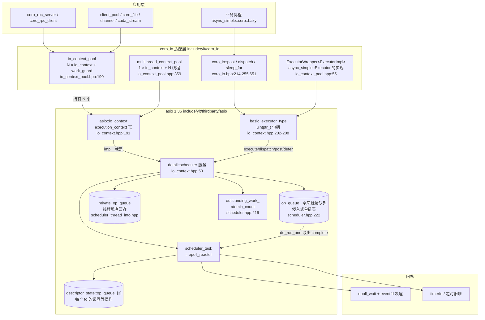

读图要点：

- `io_context` 本身几乎没有实现：构造函数里 `impl_(asio::make_service<impl_type>(*this, false))`（`asio/impl/io_context.ipp:36-52`），第二参 `own_thread=false` 表示 scheduler 不自己起线程；`run/poll/stop/restart` 全部直通 `impl_`（`asio/impl/io_context.ipp:59-104`）。
- `impl_type` 在 Linux 是 `detail::scheduler`，在 Windows IOCP 下是 `win_iocp_io_context`（`asio/io_context.hpp:48-54`）。
- `executor_type` 是 `basic_executor_type<std::allocator<void>, 0>`（`asio/io_context.hpp:208`），内部只有 `uintptr_t target_`（`io_context.hpp:969-980` 附近的 `context_ptr()` 用掩码还原 io_context 指针），因此**拷贝 executor 不产生队列，也不增加 work 计数**（除非 `require(outstanding_work.tracked)`，`io_context.hpp:650-655`）。

---

## 2. io_context：生命周期与对外接口

### 2.1 对外语义

| 接口 | 行为 | 证据 |
|---|---|---|
| `get_executor()` | 返回 `executor_type(*this)`，轻量句柄 | `asio/impl/io_context.hpp:77-81` |
| `run()` | `while (do_run_one(...))`；work 归零或 `stop()` 后返回，返回后 `stopped()==true` | `asio/detail/impl/scheduler.ipp:200-220` |
| `run_one()` | 只做一次 `do_run_one` | `scheduler.ipp:222-238` |
| `poll()` / `poll_one()` | 非阻塞版本，队列空立即返回 | `scheduler.ipp:258-287,289-314` |
| `stop()` | `stopped_=true`，唤醒所有线程，必要时打断 reactor；**不清空队列** | `scheduler.ipp:316-320,655-666` |
| `restart()` | 只把 `stopped_` 置回 false；**不动 work 计数**、不清空队列 | `scheduler.ipp:328-332` |
| `make_work_guard(io)` | 构造时 `work_started()`（计数 +1），析构/reset 时 `work_finished()` | `asio/executor_work_guard.hpp:96-101,118-122` |

### 2.2 三个关键设计

**（a）work 计数驱动退出。** `run()` 入口先检查 `outstanding_work_ == 0`，是则 `stop()` 并返回 0（`scheduler.ipp:203-207`）；循环里 `work_finished()` 把计数减到 0 时自动 `stop()`（`scheduler.hpp:105-109`）。所以"没有待处理工作"与"外部显式 stop"走的是同一条退出路径。

**（b）executor 只是句柄，不是执行体。** 它把"往哪个 io_context 投递"和"属性（blocking/relationship/outstanding_work/allocator）"编码进 `target_` 的 3 个 bit（`io_context.hpp:58-61`），`require()` 返回**同类型但 Bits 不同**的新 executor（`io_context.hpp:600-603,616-619,650-653`），`query()` 再把 bit 翻译成属性值（`io_context.hpp:759-762,777-780`）。

**（c）can_dispatch = 当前线程是否在该 scheduler 的 run() 调用栈内。** 实现是 `thread_call_stack::contains(this) != 0`（`scheduler.ipp:341-344`），而 `run/run_one/poll/poll_one` 入口都会构造 `thread_call_stack::context ctx(this, this_thread)`（`scheduler.ipp:209-213,231,269,300`）。这是 dispatch 能否内联的唯一判据。

---

## 3. executor 的三种身份（别混）

| 身份 | 类型 | 是否持队列 | 说明 |
|---|---|---|---|
| asio execution executor | `io_context::basic_executor_type<Allocator,Bits>` | 否 | 有 `execute()`，满足 `execution::is_executor`；post/dispatch/defer 通过 `require/prefer` 派生新 Bits 后再 `execute()` |
| asio TS executor | 同上（另有 `context()/on_work_*/dispatch/post/defer` 老接口） | 否 | `asio::executor`（type-erased）内部包的就是它；`asio::executor::post` 转发到 `impl<Executor>::post` → `executor_.post(f,alloc)`（`asio/impl/executor.hpp:281-293,96-109`） |
| async_simple executor | `coro_io::ExecutorWrapper<>` | 否 | 继承 `async_simple::Executor`，是**协程调度语义**的适配层；`schedule()` 最终转 `asio::post/dispatch`（`io_context_pool.hpp:101-115`） |

另外 `asio::any_io_executor` 是 `execution::any_executor<...>` 的子类，只声明支持的属性集（`asio/any_io_executor.hpp:51-76`），内部用两槽函数指针做类型擦除（`asio/execution/any_executor.hpp:865-933`）；socket/timer 等 IO 对象持有它，但最终转发到创建时传入的具体 executor。

### 3.1 三个动词的真实路径

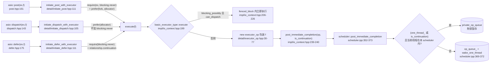

关键映射：

- `post` → `is_continuation=false`；`defer` → `is_continuation=true`；两者都禁止内联（`blocking.never`）。
- `dispatch` → 不设 `blocking.never`，所以当 `can_dispatch()` 为真时**立即在当前线程执行**，否则入队。
- `execute()` 里 `is_continuation` 取的是 `relationship_continuation` bit（`impl/io_context.hpp:239-240`），即 defer 才为 true。

---

## 4. 调度队列（核心）

### 4.1 三层队列全景

| 层 | 类型 / 字段 | 位置 | 谁写 | 谁读 |
|---|---|---|---|---|
| ① 全局就绪队列 | `op_queue<operation> op_queue_` | `detail/scheduler.hpp:222` | 任意线程（持 `mutex_`） | `run()` 线程（`do_run_one`） |
| ② 线程私有暂存 | `op_queue<scheduler_operation> private_op_queue` | `detail/scheduler_thread_info.hpp` | `post_immediate_completion` 的 `one_thread_/continuation` 快路径、reactor task | `work_cleanup` / `task_cleanup` 析构时批量并入 ① |
| ③ 每 fd 待办 | `op_queue<reactor_op> op_queue_[3]` | `detail/epoll_reactor.hpp`（`descriptor_state`） | `start_op` | `perform_io`（就绪后） |

另外两个"队列相关"的特殊对象：

- `task_operation_`：一个**空壳 operation**（构造函数传 `operation(0)`，`scheduler.hpp:204-207`），它本身不执行任何东西，只代表"reactor task 在队列中的位置"。`init_task()` 把它 push 进 `op_queue_`（`scheduler.ipp:189-198`），之后每次被 `do_run_one` 弹出就触发一次 `task_->run()`（即 `epoll_wait`），`task_cleanup` 再把它放回队尾。
- `descriptor_state`：继承 `operation` 的占位 op（`epoll_reactor.ipp:773-777`），`task_result_` 里存 epoll 事件掩码，`complete()` 时才真正分发用户 handler（`:818-829`）。

### 4.2 op_queue：最小侵入式链表

`template <typename Operation> class op_queue`（`detail/op_queue.hpp:62-155`）：

- 只有 `front_` / `back_` 两个指针（`:150-154`）；
- 链接指针 `next_` 直接藏在 operation 对象里（`op_queue_access::next()`，`:28-60`；对 `scheduler_operation` 就是 `scheduler_operation* next_`，`scheduler_operation.hpp:66`）；
- `push(op)` O(1) 尾插（`:103-116`）；`pop()` O(1) 头删并清 `next_`（`:91-101`）；`push(op_queue<Other>& q)` 整链 splice，源队列清空（`:120-133`）——线程私有队列并入全局队列就靠它；
- `is_enqueued(op)` 用 `next_!=0 || back_==op` 判断（`:142-145`），reactor 用它去重同一个 fd 的多次事件。

入队/出队零内存分配，这是 asio 调度器高性能的根本。

### 4.3 四条入队路径

`detail/impl/scheduler.ipp` 里只有四个插入函数：

| 函数 | 先 work_started? | 行为 | 使用方 |
|---|---|---|---|
| `post_immediate_completion(op,is_cont)` `:352-373` | 是（快路径记在线程私有计数上） | 快路径进 ②；否则 `work_started()` + 加锁 push ① + `wake_one_thread_and_unlock` | `executor_op` 入队（post/dispatch/defer/execute 的最终落点） |
| `post_immediate_completions(n,ops,is_cont)` `:375-397` | 是 | 批量版 | 少量内部服务 |
| `post_deferred_completion(s)(ops)` `:399-437` | **否**（调用方已计过 work） | 直接 push ① + 唤醒；`one_thread_` 时优先 ② | reactor 完成、timer 到期 |
| `do_dispatch(op)` `:439-446` | 是 | 只入队不内联（内联判定在调用方） | 本树内未发现调用者 |

### 4.4 do_run_one：调度器心脏（逐行）

`do_run_one(lock, this_thread, ec)`（`scheduler.ipp:455-525`）的骨架：

```cpp
while (!stopped_) {                                   // :459
  if (!op_queue_.empty()) {                           // :461
    operation* o = op_queue_.front(); op_queue_.pop();// :464-465
    bool more_handlers = !op_queue_.empty();          // :466

    if (o == &task_operation_) {                      // :468  ← reactor 任务标记
      task_interrupted_ = more_handlers || task_usec_ == 0;      // :470
      if (more_handlers && !one_thread_ && wait_usec_ != 0)
        wakeup_event_.unlock_and_signal_one(lock);    // :473  叫醒另一个线程分担
      else
        lock.unlock();                                // :475
      task_cleanup on_exit = { this, &lock, &this_thread };      // :477
      task_->run(more_handlers ? 0 : task_usec_,
                 this_thread.private_op_queue);       // :483-484  ← epoll_wait
    }
    else {                                            // 普通 operation
      std::size_t task_result = o->task_result_;      // :488
      if (more_handlers && !one_thread_)
        wake_one_thread_and_unlock(lock);             // :490-491
      else
        lock.unlock();                                // :493
      work_cleanup on_exit = { this, &lock, &this_thread };      // :496
      o->complete(this, ec, task_result);             // :500  ← 执行用户 handler
      this_thread.rethrow_pending_exception();        // :501
      return 1;                                       // :503
    }
  }
  else {                                              // 队列空
    if (wait_usec_ == 0) { lock.unlock(); lock.lock(); }        // :508-512 忙等
    else { wakeup_event_.clear(lock); wakeup_event_.wait(lock); } // :515-519 阻塞
  }
}
return 0;                                             // :524
```

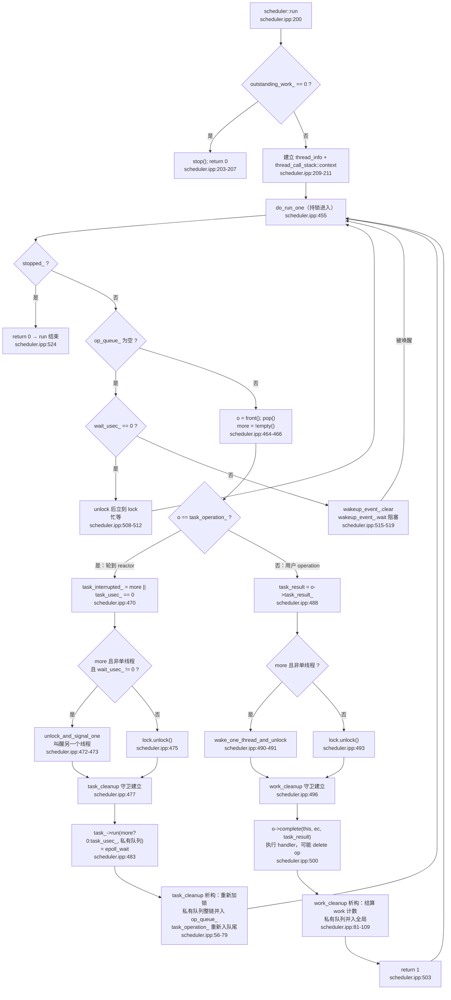

> `run()` 的循环形状是 `for (; do_run_one(lock,...); lock.lock())`（`scheduler.ipp:216`）：`do_run_one` 在 `complete()` 前 `unlock`，返回 1 后循环体再 `lock.lock()`，因此**用户 handler 永远在不持锁状态下执行**（这也是重入/死锁分析的依据）。

### 4.5 task_operation_ 与 reactor 的协作

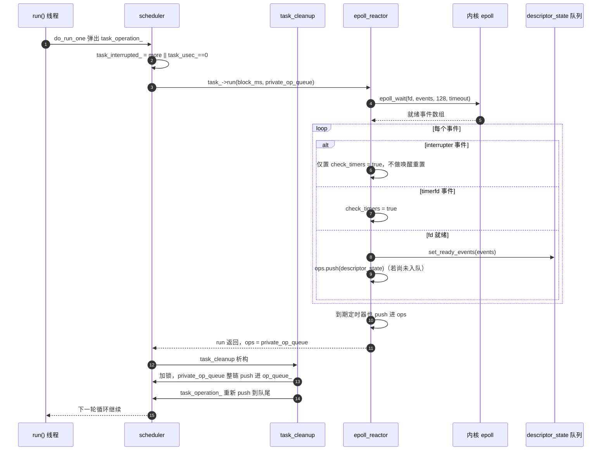

要点：

- **reactor 不把用户 op 直接放进 scheduler 队列**，而是把"就绪的 fd 状态对象"放进线程私有队列；真正用户 op 在 `descriptor_state::complete()` 里才被分发。
- `epoll_reactor::run()` 开头的注释（`epoll_reactor.ipp:502-506`）说明了设计前提：scheduler 保证 reactor task 排在本轮返回的 descriptor operation 之后，所以这些 `descriptor_state` 可以被复用。
- 事件去重：同一个 fd 一轮内多次事件时，`ops.is_enqueued(descriptor_data)` 为真则只 `add_ready_events` 合并掩码（`epoll_reactor.ipp:588-600`）。

### 4.6 唤醒：两条互斥路径

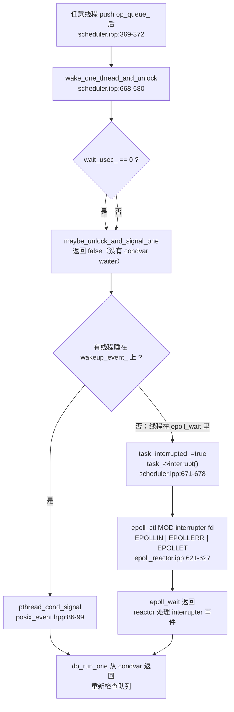

关键点：

- `wakeup_event_` 是 `conditionally_enabled_event`，Linux 下是 `posix_event`（pthread 条件变量 + 互斥量）。`maybe_unlock_and_signal_one` 返回"是否有 waiter"，没有 waiter 说明线程十有八九阻塞在 `epoll_wait` 里。
- reactor 的 interrupter 在构造时就已加入 epoll 并保持可读、注册为**边沿触发 EPOLLET**（`epoll_reactor.ipp:56-61`），因此一次 `epoll_ctl MOD` 就能让 `epoll_wait` 返回；`interrupt()` 本身**不 write eventfd**，靠 ET + 注册更新唤醒（`epoll_reactor.ipp:566-579` 的注释明确说明不 reset interrupter）。
- 单线程优化 `one_thread_` 下，跨线程投递仍然走共享队列 + 锁 + 唤醒（`thread_call_stack::contains` 在别的线程为 null），所以线程安全不依赖 hint。

### 4.7 work 计数生命周期

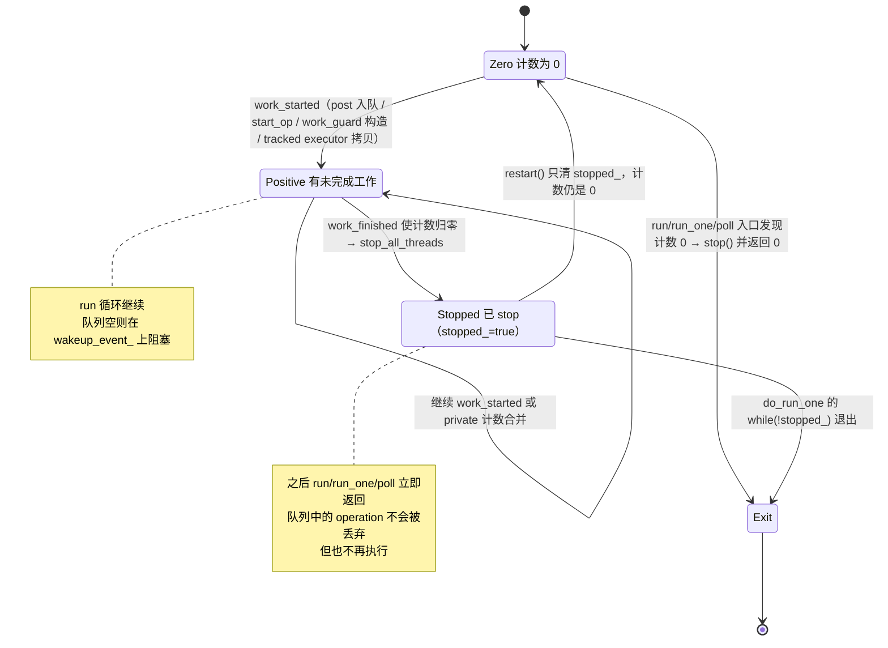

work 记在哪：

| 动作 | 计数操作 | 证据 |
|---|---|---|
| 普通线程 post/dispatch/defer 入队 | `work_started()` | `scheduler.ipp:369` |
| 批量 immediate completion | `increment(outstanding_work_, n)` | `scheduler.ipp:393` |
| 快路径进私有队列 | 只加 `private_outstanding_work`，handler 退出时由 `work_cleanup`/`task_cleanup` 归还 | `scheduler.ipp:356-363,60-66,85-94` |
| 发起 IO（`start_op` 挂到 fd 队列） | `scheduler_.work_started()` | `epoll_reactor.ipp:342-343` |
| timer 挂起 | `scheduler_.work_started()` | `detail/impl/epoll_reactor.hpp` 的 timer 入队路径 |
| 每次 operation 完成 | `work_cleanup` 析构里 `work_finished()` | `scheduler.ipp:81-94` |
| descriptor_state 本身不算 work | `compensating_work_started()` 抵消 | `epoll_reactor.ipp:740-771` |

> `work_finished()` 里 `if (--outstanding_work_ == 0) stop();`（`scheduler.hpp:105-109`）是"任务做完了 run 自动返回"的机制核心。

### 4.8 IO 完成路径（epoll → handler）

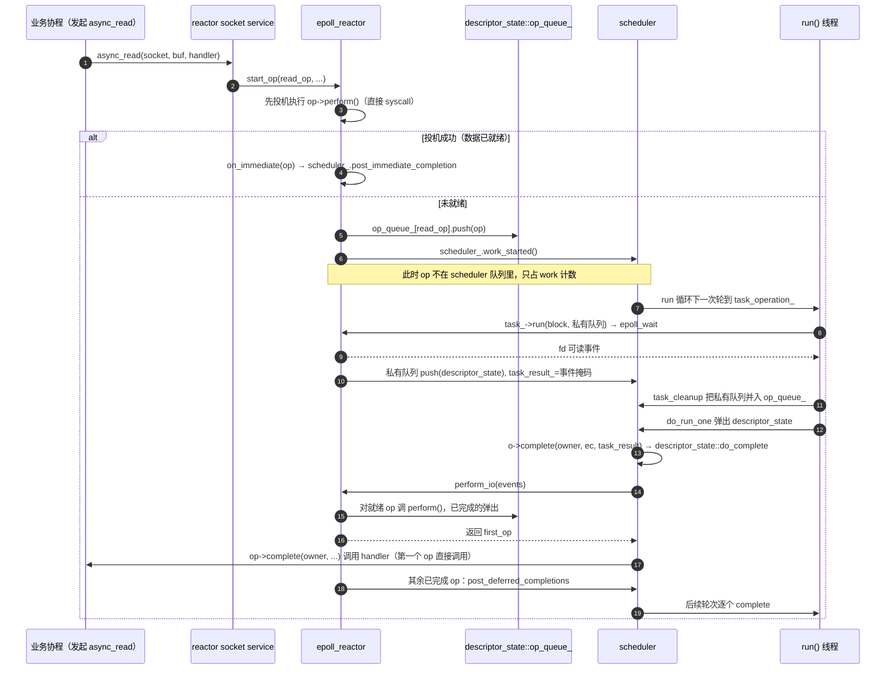

### 4.9 单线程 `one_thread_` 快路径与顺序保证

`io_context_pool` 构造 `asio::io_context(1)`（`io_context_pool.hpp:202`），asio 把 hint=1 映射成 `ASIO_CONCURRENCY_HINT_1`，`scheduler` 因此 `one_thread_=true`（`scheduler.ipp:111-135` 中 `config(ctx).get("scheduler","concurrency_hint",0)==1`）。带来的效果：

1. **同线程 post 永不递归内联**：即使当前线程就在该 io_context 的 `run()` 内，`post_immediate_completion` 也会把 op 塞进 `private_op_queue`（`scheduler.ipp:356-363`），等当前 handler 返回后由 `work_cleanup` 析构把私有队列整链并入 `op_queue_`（`scheduler.ipp:97-103`）。语义 = "下一个 handler 边界执行"。
2. **顺序**：全局队列 FIFO；私有队列是"当前 handler 期间新产生的 op"，在 handler 结束时**追加到全局队列尾部**，因此整体仍是 FIFO（多线程场景由 `mutex_` 保证入队原子性，但**出队顺序取决于哪个线程先抢到锁**）。
3. **锁仍开启**：`ASIO_CONCURRENCY_HINT_1` 是普通数值 1，不是 `ASIO_CONCURRENCY_HINT_UNSAFE`，所以跨线程投递依然安全（`detail/concurrency_hint.hpp:60-92`）。

---

## 5. coro_io 层：ExecutorWrapper 与 io_context_pool

### 5.1 ExecutorWrapper：async_simple::Executor 的 asio 适配器

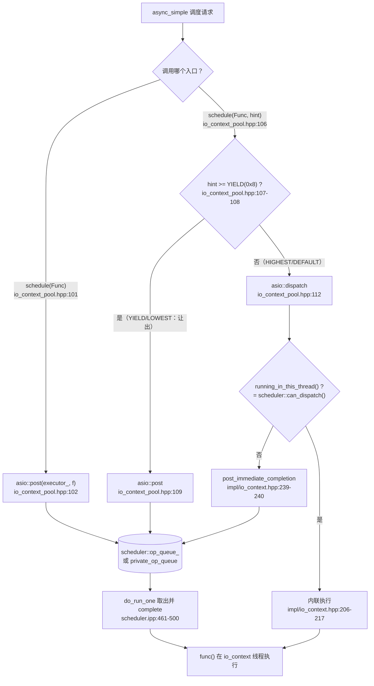

其它接口映射：

| async_simple 契约 | ylt 实现 | 行号 |
|---|---|---|
| `schedule(Func)` 必执行/返回 false | `asio::post` 后恒返回 true | `:101-104` |
| `schedule(Func, info)`：`>=YIELD` 不得总立即执行 | `>=YIELD→post`，否则 `dispatch` | `:106-115` |
| `checkout()` 返回上下文 | `&executor_.context()`（`asio::io_context*`） | `:123` |
| `checkin(func, ctx)` 投回同一上下文 | `asio::post(*(io_context*)ctx, func)` | `:117-122` |
| `currentThreadInExecutor()` | `executor_.running_in_this_thread()` | `:131-133` |
| `currentContextId()` | `(size_t)&context` | `:135-137` |
| `after(dur[,info,slot])` 定时 | `asio::steady_timer` + `Signal` 取消 | `:147-179` |
| `stat()` / `getIOExecutor()` | **未实现**（基类抛 `logic_error`） | 缺失 |

定时器取消路径（`co_await async_simple::coro::sleep`）：`Signal::tryEmplace` 注册 `Terminate` 处理器，与主流程用 `atomic<bool>` CAS 抢占"取消 vs 正常到期"的先后；被取消时 `timer.cancel()`，handler 以 `operation_aborted` 被调用，`fn()` 恢复协程，最终由 `await_resume()` 里的 `checkHasCanceled` 抛 `SignalException`（`Executor.h:213-216`、`Signal.h:389-400`）。

### 5.2 io_context_pool 内部结构

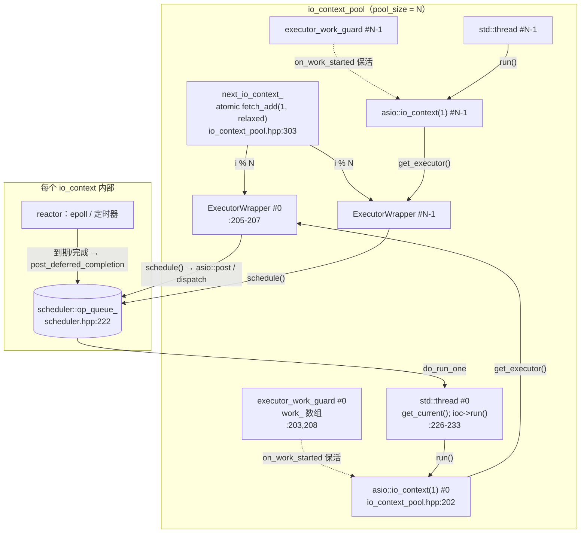

要点：

- `io_contexts_[i]` / `executors[i]` / `work_[i]` 在同一循环同序 push，下标严格一一对应（`:201-209`），所以 `% io_contexts_.size()` 索引 `executors` 安全。
- `total_thread_num_` 是进程级 `inline static std::atomic<size_t>`，只增不减（`:199,352`）。
- `run()` 用 CAS 保证只生效一次（`:213-217`），重复 `run()` 静默返回；每线程先设 `thread_local get_current()=io_context*` 再 `run()`（`:229-231`），这是 `sleep_for` 缺少 async_simple executor 时的兜底定位手段。
- Linux 下可选 CPU 亲和：`sched_getaffinity` 枚举可用 CPU，`pthread_setaffinity_np` 绑定（`:219-252,317-342`）。

### 5.3 round-robin 分配与 coro_rpc 的取用时机

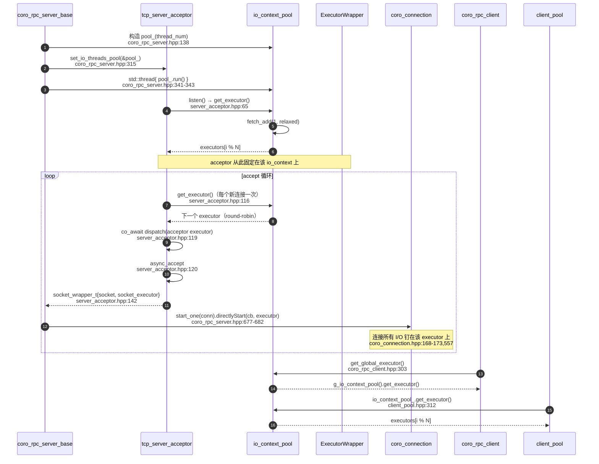

### 5.4 io_context_pool 生命周期

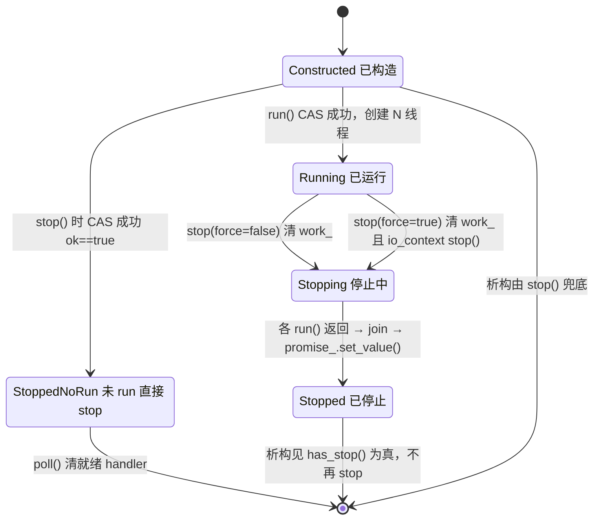

`stop()` 的精确链条：

```mermaid
flowchart LR
    A["io_context_pool::stop()<br/>io_context_pool.hpp:261"] --> B["call_once<br/>:262"]
    B --> C["ok = CAS has_run_or_stop_<br/>:263-264"]
    C --> D["每个 wrapper schedule(clear_all_data)<br/>:266-270"]
    D --> E["work_.clear()<br/>:272"]
    E --> F["~executor_work_guard<br/>on_work_finished<br/>executor_work_guard.hpp:118-122"]
    F --> G["scheduler::work_finished<br/>--outstanding_work_ == 0<br/>scheduler.hpp:105-109"]
    G --> H["scheduler::stop()<br/>stop_all_threads<br/>scheduler.ipp:655-666"]
    H --> I["do_run_one while(!stopped_) 退出<br/>scheduler.ipp:459"]
    I --> J["各线程 run() 返回 → join<br/>io_context_pool.hpp:255-257"]
    J --> K["promise_.set_value()<br/>:258"]
    K --> L["stop() 中 promise.wait() 返回<br/>:282-283"]
```

`force=false`（默认）：已挂起的 I/O 会先完成，`run()` 才退出——**析构可能长时间阻塞**。`force=true`：额外 `io_context::stop()` 立刻置 `stopped_`，未执行的 operation 被放弃。

---

## 6. 协程如何在 executor 上恢复

### 6.1 `co_await coro_io::post(func, executor)`

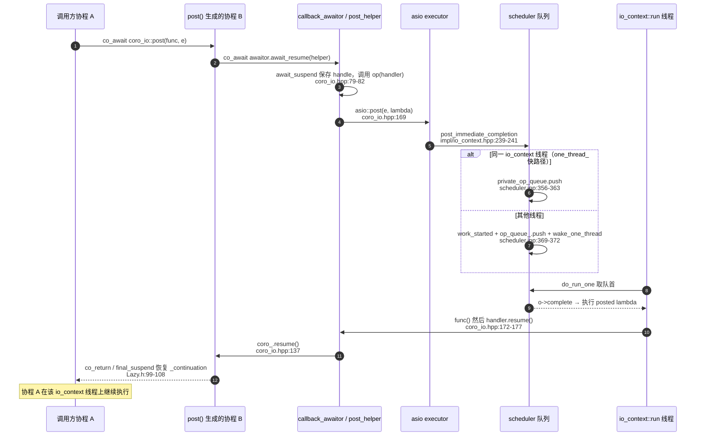

关键：这条链**不经过** `async_simple::Executor::checkin`。`coro_io::post` 只借 asio 队列把 `func` 跑到目标线程，并在 handler 里直接 `resume()` 协程；协程的 `_executor`（用于后续 `Yield`/`RescheduleLazy`/`Future` continuation）仍是原先 `coAwait` 继承的那个。

### 6.2 async_simple 的三条热路径

| 场景 | 调用 | 最终落点 |
|---|---|---|
| `co_await Yield` | `_executor->schedule(handle, YIELD)`（`Lazy.h:126-131`） | `ExecutorWrapper::schedule(hint)` → `>=YIELD` → `asio::post` |
| `RescheduleLazy` 启动 | `pr._executor->schedule(handle)`（`Lazy.h:362-370`） | 1 参 `schedule` → `asio::post` |
| `co_await sleep(d)` | `Executor::after` → 4 参 `schedule(handle,dur,DEFAULT,slot)`（`Executor.h:209-212`） | `steady_timer::async_wait` → reactor → `post_deferred_completion` |
| `Future` continuation | `scheduleContinuation()`（`FutureState.h:265-308`）：已在 executor 内则原地执行；否则 1 参 `schedule` 或 `checkin(_context)` | 同 context 的 `asio::post` |

---

## 7. coro_rpc 侧的实际使用

- **服务端**：默认配置 `executor_pool_t = coro_io::io_context_pool`（`coro_rpc_config.hpp:66`）；`pool_(thread_num)`（`coro_rpc_server.hpp:138`）；listen 时 acceptor 取一次 executor 并固定；每个连接再取一次，`socket_wrapper_t` 随连接携带 executor（`server_acceptor.hpp:116-142`）；连接内部用 `executor->schedule(...)`/`asio::dispatch(socket_executor, ...)` 把所有回调和响应拉回本线程（`coro_connection.hpp:373-383,476-519,537-544`）。
- **客户端**：默认 `coro_io::get_global_executor()`（`coro_rpc_client.hpp:303`），即从全局池 round-robin 取；每个 client 的 timer/socket 都绑定该 executor；关闭时用 `co_await coro_io::post([](){}, executor)` 排空。
- **client_pool**：保存 `io_context_pool&` 引用，新建客户端时 `io_context_pool_.get_executor()`（`client_pool.hpp:312-313`），与全局池同源。
- **负载特征**：连接在 accept 时绑定 executor，**生命周期内不迁移**——没有工作窃取/再平衡；长尾连接会占住某个 io_context 线程。

---

## 8. Windows（IOCP）分支差异

本仓库自带 `win_iocp_io_context`（`asio/io_context.hpp:48-54`），接口与 `detail::scheduler` 对齐，但"队列"换成内核完成端口：

| 维度 | Linux（scheduler + epoll） | Windows（win_iocp_io_context） |
|---|---|---|
| 队列本体 | 用户态侵入式链表 `op_queue_` | IOCP 内核队列 + `completed_ops_` 兜底链表 |
| 入队 | `op_queue_.push` + 唤醒 | `PostQueuedCompletionStatus(op)`；失败则进 `completed_ops_` 并置 `dispatch_required_`（`win_iocp_io_context.ipp:330-338,340-360`） |
| 出队 | `do_run_one` 从链表 pop | `GetQueuedCompletionStatus` 阻塞取（`ipp:457-459`）→ `op->complete`（`:490-499`） |
| 唤醒/停止 | condvar 或 reactor interrupt | `stop()` 投递一个空 completion（`ipp:297-309`），`do_one` 收到后检查 `stopped_` 并转唤醒下一个线程（`ipp:519-548`） |
| 定时器 | reactor task 里统一处理 | `dispatch_required_` 抢占 + `timer_queues_.get_ready_timers`（`ipp:439-449`） |

对上层（coro_io）无感知：post/dispatch/execute 语义、work 计数、`run()/stop()` 行为均一致。

---

## 9. 结论、风险与使用建议

### 9.1 调度语义总结

1. **投递语义**：`post` 保证"不在当前调用栈内联"（对同一线程也一样，因 `blocking.never` + `one_thread_` 私有队列）；`dispatch` 在目标线程上则内联；`defer` 在 handler 返回后才被合并执行。
2. **执行线程**：handler 只在某个调用 `run()/poll()/run_one()` 的线程上执行；一条 operation 只执行一次。
3. **顺序**：单队列 FIFO；线程池下完成顺序受竞争影响；无优先级、无公平性保证（repeater 可以饿死后续任务）。
4. **生命周期**：work 计数归零 = 自动 stop；`run()` 返回后必须 `restart()` 才能再次运行（且要重新产生 work）。
5. **线程模型**：`io_context_pool` 是"每 io_context 单线程"（`io_context(1)` + 每 context 一个 run 线程），因此 `ExecutorWrapper` 的 `execute` 除跨线程投递外都是串行的；`multithread_context_pool` 相反（1 个 context，N 线程共享）。

### 9.2 代码中值得注意的点

| # | 现象 | 位置 | 影响 |
|---|---|---|---|
| 1 | `schedule(hint)` 用整个 64 位 `hint` 与 `YIELD` 比较，未取低 4 位 | `io_context_pool.hpp:107-108` | 当前 async_simple 只传 0/0x7/0x8，行为正确；未来 hint 高位带元信息会误判为"低优先级" |
| 2 | `schedule(Func, Duration)` override 是死代码（基类改为委托 4 参） | `io_context_pool.hpp:140-146` vs `Executor.h:173-177` | 维护时易误以为 sleep 走这里 |
| 3 | `stat()` / `getIOExecutor()` 未实现，基类抛 `logic_error` | `Executor.h:137-139,166-170` | 第三方按契约调用会抛异常 |
| 4 | `stop()` 里 `clear_all_data` 以**引用捕获循环变量**并异步投递 | `io_context_pool.hpp:266-270` | `force=true` 丢弃 operation 时清理可能不执行（不影响正确性，影响"停止后已清"的预期） |
| 5 | `~io_context_pool()` 默认 `force=false`，会等所有未完成 I/O | `io_context_pool.hpp:287-290,282-283` | 析构可能长时间阻塞，快速退出需显式 `stop(true)` |
| 6 | `has_stop()` 只看 `work_.empty()`，不代表线程已 join | `io_context_pool.hpp:298` | 并发 stop 场景下该推断不成立 |
| 7 | `current_io_context()` 返回 `next_io_context_-1`，未取模 | `io_context_pool.hpp:300` | 未分配前下溢；仅诊断用 |
| 8 | `multithread_context_pool::run()` 无幂等；`promise_.set_value()` 在线程刚创建后就调用 | `io_context_pool.hpp:368-375` | 重复 run 会重复建线程；stop 的 wait 实际没等线程结束 |
| 9 | 连接在 accept 时绑定 executor，不迁移 | `server_acceptor.hpp:116-142` | 无工作窃取，长尾连接造成线程间不均衡 |
| 10 | `ExecutorWrapper::schedule` 恒返回 true，`asio::post` OOM 会抛异常 | `io_context_pool.hpp:101-115` | 极端情况下违反"返回 true 即保证执行"契约 |

---

## 10. 关键行号速查

| 主题 | 位置 |
|---|---|
| io_context / executor_type / get_executor | `asio/io_context.hpp:191,208`；`asio/impl/io_context.hpp:77-81` |
| io_context 构造（scheduler 服务，own_thread=false） | `asio/impl/io_context.ipp:36-52` |
| run/poll/stop/restart 直通 | `asio/impl/io_context.ipp:59-104` |
| basic_executor_type 的 execute/dispatch/post/defer | `asio/impl/io_context.hpp:199-242,268-295,299-313,317-331` |
| executor 属性 bit（blocking/relationship/tracked） | `asio/io_context.hpp:58-61`；`require` `:600-671`；`query` `:759-780` |
| post/dispatch/defer 的自由函数与 initiate_* | `asio/post.hpp:158-207`；`asio/dispatch.hpp:143-191`；`asio/detail/initiate_post.hpp:111-118`；`detail/initiate_dispatch.hpp:105-107` |
| executor_op 包装与完成 | `asio/detail/executor_op.hpp:30-77` |
| scheduler 字段与 work 计数 | `asio/detail/scheduler.hpp:38-232`（`op_queue_:222`、`task_:198`、`task_operation_:204-207`、`work_started/finished:95-109`） |
| op_queue 侵入式链表 | `asio/detail/op_queue.hpp:62-155` |
| scheduler_operation（next_/func_/task_result_） | `asio/detail/scheduler_operation.hpp:31-71` |
| init_task（task_operation_ 入队） | `asio/detail/impl/scheduler.ipp:189-198` |
| post_immediate_completion / deferred 版本 | `scheduler.ipp:352-373,375-437` |
| do_run_one 主循环 | `scheduler.ipp:455-525` |
| task_cleanup / work_cleanup | `scheduler.ipp:56-79,81-109` |
| can_dispatch / wake_one_thread_and_unlock | `scheduler.ipp:341-344,668-680` |
| stop_all_threads / restart | `scheduler.ipp:655-666,328-332` |
| epoll_reactor run / interrupt / perform_io | `epoll_reactor.ipp:500-619,621-627,779-829` |
| start_op / 每 fd 队列 + work_started | `epoll_reactor.ipp:254-344` |
| win_iocp_io_context 队列与 do_one | `win_iocp_io_context.ipp:297-338,434-549` |
| ExecutorWrapper（schedule/checkin/定时器） | `include/ylt/coro_io/io_context_pool.hpp:55-180` |
| io_context_pool（构造/run/stop/get_executor） | `include/ylt/coro_io/io_context_pool.hpp:190-353` |
| multithread_context_pool / 全局单例 | `include/ylt/coro_io/io_context_pool.hpp:359-401,403-453` |
| coro_io::post / dispatch / sleep_for / channel | `include/ylt/coro_io/coro_io.hpp:166-255,616-700` |
| async_simple Executor / Priority / after | `include/ylt/thirdparty/async_simple/Executor.h:72-252` |
| Lazy YieldAwaiter / CurrentExecutor / via | `include/ylt/thirdparty/async_simple/coro/Lazy.h:112-141,155-157,594-599` |
| Future 续体调度 | `include/ylt/thirdparty/async_simple/FutureState.h:265-308` |
| coro_rpc 服务端取 executor | `include/ylt/coro_rpc/impl/coro_rpc_server.hpp:315,341-343,677-682`；`include/ylt/coro_io/server_acceptor.hpp:65,116-142` |
| coro_rpc 客户端 / client_pool | `include/ylt/coro_rpc/impl/coro_rpc_client.hpp:302-315`；`include/ylt/coro_io/client_pool.hpp:312-313` |

---

## 附录：配套文档

- `docs/analysis/asio_scheduler.md`：asio 侧的逐行分析（组件、do_run_one、唤醒、reactor、work count、版本宏）。
- `docs/analysis/coro_io_executor.md`：coro_io 侧逐行分析（ExecutorWrapper、io_context_pool、post/dispatch、async_simple 契约、coro_rpc 使用方、风险）。

---

## 附录二：渲染后的图（PNG）

| 文件 | 内容 |
|---|---|
| `docs/analysis/img/fig01_architecture.png` | 分层架构总图（§1） |
| `docs/analysis/img/fig02_post_dispatch_defer.png` | post / dispatch / defer 到入队的路径（§3.1） |
| `docs/analysis/img/fig03_do_run_one_loop.png` | do_run_one 调度主循环（§4.4，核心） |
| `docs/analysis/img/fig04_reactor_task.png` | task_operation_ 与 reactor 的协作（§4.5） |
| `docs/analysis/img/fig05_wakeup_paths.png` | 两条唤醒路径（§4.6） |
| `docs/analysis/img/fig06_work_count_state.png` | work 计数生命周期（§4.7） |
| `docs/analysis/img/fig07_io_completion.png` | IO 完成路径 epoll → handler（§4.8） |
| `docs/analysis/img/fig08_schedule_hint_branch.png` | ExecutorWrapper::schedule(hint) 分支（§5.1） |
| `docs/analysis/img/fig09_pool_structure.png` | io_context_pool 内部结构（§5.2） |
| `docs/analysis/img/fig10_round_robin.png` | round-robin 分配与 coro_rpc 取用（§5.3） |
| `docs/analysis/img/fig11_pool_lifecycle.png` | io_context_pool 生命周期（§5.4） |
| `docs/analysis/img/fig12_stop_chain.png` | stop() 关闭链条（§5.4） |
| `docs/analysis/img/fig13_coro_post_resume.png` | co_await coro_io::post 的协程恢复链路（§6.1） |
